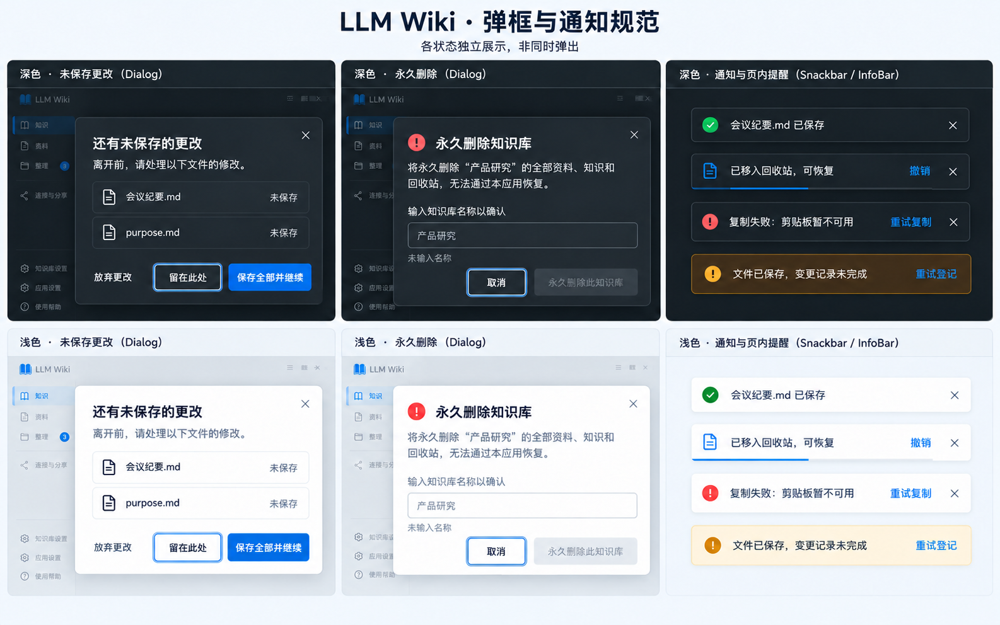

# LLM Wiki｜总体架构与实现约定

> 页面整合版，2026-10-30。技术架构保持 .NET 10 + C# + WPF + WPF-UI 4.3.0 + MVVM，全 WPF，无 WebView2。本文是全局唯一规则；每个页面文件包含该页控件、样式、状态、命令、实现步骤和细节。文档与概念图是待实施规格，不代表程序已经修复。

## 1. 产品边界与文档组织

本地知识库维护与外部 AI 任务工作台：资料保持源格式，外部 AI 生成知识，用户核对完成。可以管理本机外部 Agent 进程，但不内置模型/聊天/API Key，不做云同步、图谱、数据库、无人值守执行和复杂并发调度。

只保留七个页面：知识、资料、整理、连接与分享、知识库设置、应用设置、使用帮助。不保留重复仪表盘和七卡并列工作流；建库/切库集中在顶栏库选择器。

阅读顺序：本文 → 对应页面 → 使用说明 → 实施步骤与验收。页面文件是实现该页的完整任务包，无需翻找按历史修订累积的章节。跨页共享规则集中在本文，页面不得另定义相反逻辑。图中示例内容、日期与路径不是固定程序数据。

## 2. 总体架构不变

```text
WPF-UI 4.3.0 Shell（FluentWindow / NavigationView / Dialog / Snackbar）
  ├─ 七页 View + 各页 ViewModel + 公共业务组件
  └─ 应用服务
      ├─ 库上下文 / 文件 / 原格式读取 / 变更 / 规则 / 配置
      ├─ 扫描基线 / 可恢复操作 / 任务快照与逐项确认 / 回收站
      ├─ 共用任务上下文生成器
      ├─ 本机 Agent 适配器 → 外部 CLI 进程（不内置模型）
      └─ Kestrel 浏览分享 / HTTP MCP（独立权限与生命周期）
          + 可选独立只读 stdio MCP
                    ↓
            真实文件知识库，不引入数据库
```

类名沿用实际项目，不为匹配文档批量重命名。View 不直接写文件；可执行命令与 CanExecute 在 VM，权限/版本/事务恢复在服务，样式和主题在资源字典。

独立任务、草稿、列表、loading、total 等状态按业务分块，不放进无边界大 state。不同页面可共享服务，但不能共享会互相覆盖的编辑缓冲。异步请求携带库上下文版本，过期结果丢弃；文件写入目标不能随 UI 选择变化。

## 3. 文件数据契约

```text
<根目录>/<库名>/
├─ purpose.md                 目标与边界
├─ schema.md                  组织规则
├─ .changes.json              既有待整理记录格式
├─ .llmwiki/
│  ├─ manifest.json           完整扫描基线，不等同已处理依据
│  ├─ tasks/<taskId>.json     冻结范围、源/规则版本、确认进度
│  ├─ operations/<id>.json    文件/确认操作与补记凭据
│  ├─ reviews.json            规则核对、人工修订保护
│  └─ trash/<id>/             回收文件、覆盖前版本与元信息
├─ raw/sources/               原格式资料：办公文档/PDF/表格/演示/文本/结构化数据/图片
├─ raw/assets/                已有资源
└─ wiki/                      index、overview、log与知识分类目录
```

上传保留原名、后缀与原字节，不转 Markdown、不重编码、不生成 .docx.md/.pdf.md等副本；单文件上限20 MiB（20,971,520字节），多选逐文件提交，协议封装另计。以下格式均纳入添加、列举、源版本扫描、下载、任务选择与回收恢复；上传能力、页内预览、原位编辑和AI读取分别判断。

### 3.1 统一格式支持表

| 类别 | 支持添加的扩展名（大小写不敏感） | 页内预览/编辑基线 | AI读取要求 |
|---|---|---|---|
| 文本 | .md .markdown .txt .log | Markdown安全阅读或纯文本；符合大小/编码条件可原位编辑 | 文本读取，报告编码与完整范围 |
| Word及兼容文档 | .docx .docm .doc .rtf .odt .wps | DOCX/DOCM段落和表格的只读内容预览；其他格式有已验证读取器则预览，否则原件卡+系统打开；不原位编辑 | 按具体格式验证；旧版DOC、RTF、ODT、WPS不能用DOCX能力代替 |
| 电子表格 | .xlsx .xlsm .xls .csv .tsv .ods .et | XLSX/XLSM工作表只读网格；CSV/TSV只读网格或原文；符合条件的CSV/TSV可编辑原文；其他格式按已验证读取器或原件卡 | 按工作表/行列范围读取，保留公式/缓存值区别；不能只读第一张表就当整份完成 |
| 演示文稿 | .pptx .pptm .ppt .odp .dps | PPTX/PPTM按页的只读文字/备注预览；其他格式按已验证读取器或原件卡；不提供幻灯片编辑器 | 按真实幻灯片顺序、备注和覆盖范围验证；PPT不等同PPTX |
| PDF | .pdf | 按页文字预览；扫描页/无文本页明确提示，原版面查看交系统程序；不原位编辑 | 文本提取、视觉读取/OCR分别验证，扫描件不能因提取为空就判空文档 |
| 结构化数据 | .json .jsonl .xml .yaml .yml .toml .ini | 默认原文预览/编辑，已有校验器则就地显示语法状态；不自动美化、排序或改键值类型 | 按原始文本/行读取；语法错误与读取失败分开，不执行内容 |
| 图片 | .png .jpg .jpeg .webp .bmp .gif .tif .tiff .svg | 现有WPF解码器支持的格式静态缩放预览；其他原件卡。GIF不承诺播放，TIFF不隐去多帧，SVG不嵌入活动网页；不改图 | 视觉/OCR能力独立验证，不能以文件名或元数据当作已读图片内容 |

“支持添加”至少意味着原字节完整保存、管理、下载与恢复，不要求安装Office。DOCX/XLSX/PPTX及PDF文字内容预览属于本次实现基线；复杂版式、图表、图片与扫描OCR不冒充已支持。加密/损坏但能够安全保存的资料可按原件存档，明确不可解析原因；不索取口令写入配置/日志，不绕过保护。宏文件只保留/读取文档内容，不执行宏、脚本、嵌入对象或外链。

压缩包、可执行程序、安装包、音视频及未列出的扩展名不作为本次资料类型；不使用“所有文件”假装无限支持。不支持项逐项说明，不影响同批合法文件；未知历史文件仍可显示原件信息和导出，不自动删除。

### 3.2 格式能力与读取器合同

由同一个项目SourceFormatRegistry提供分类、扩展名集合、上传资格、PreviewProvider、EditMode与ExtractionProvider；文件选择器、列表筛选、扫描、任务包、MCP和下载共享该注册表，不在每页各写一套四格式判断。先复用已有实现，再补独立.NET读取适配器，不改变WPF/MVVM架构、不引入数据库或WebView2，不以Office COM自动化作为上传前提。

现代Office可采用[Open XML SDK](https://learn.microsoft.com/en-us/office/open-xml/open-xml-sdk)做内容读取；PDF文字读取可采用[PdfPig](https://github.com/UglyToad/PdfPig)。工程须复用/选择实际兼容的版本并锁定依赖。这些读取器不等于Office/PDF版式渲染器，也不等于旧版DOC/XLS/PPT或OCR读取器；未适配时显示真实原件状态。

读取结果至少包括sourceVersion、format、定位信息、内容范围、extractedKinds、omittedKinds、warnings、requiresOcr、nextCursor和complete。complete仅表示声明的内容流传输完成，不能掩盖未提取图片/备注/图表等遗漏；后续续读固定原字节版本。加密、损坏、无读取器、需要OCR、超出读取预算、版本变化分别返回具体状态，不把它们合并为上传失败或无需整理。

读取解析在后台可取消，设置解压/对象数量/页行数/时间与内存预算，压缩后的20MiB不等于可无限展开。提取结果用于内存/受控临时读取，不新增Markdown资料、不替换原件、不凭预览内容重算源哈希。JSON等资料仅限允许的raw/sources路径；扩展格式不会开放读取内部JSON、规则或凭据。

源标识为规范化库内相对路径，版本为原字节 SHA256；删除有稳定 tombstone/记录版本。日志时间、检查时间和 JSON 字段排序不能改变源版本。来源引用写真实源文件名，知识保持 sources frontmatter 和 wikilink 约定。

新上传不建立 raw/original；历史原件/派生物/人工修改文件不自动搬移、覆盖或删除。可靠映射后兼容读取；历史派生变更保留原身份，不能凭后缀猜测后清除。`.changes.json` 的结构与合并规则先从源码核实，使用适配层，不猜格式重写。

## 4. 安全边界与服务合同

所有文件服务接收明确库身份和相对路径，拒绝盘符、绝对/UNC 文件参数、..、控制字符、链接/junction 越界。配置根目录可以是 UNC，不能借此放开库内相对路径校验。隐藏目录仍须在 API 层拒绝直接访问。

| 服务职责 | 最低合同 |
|---|---|
| 库与上下文 | 合法名称、唯一库选择、创建骨架、上下文版本、只显式删库 |
| 文件 | 精确路径、字节/内容读写、版本条件、原子单文件替换 |
| 资料读取 | 原格式能力、范围/截断/失败，不落盘衍生 Markdown |
| 扫描/变更 | 完整扫描与相关路径核验、稳定身份、变更去重、比较后确认 |
| 任务 | 准备快照、复制/启动/导出、逐项确认回执、主动核对与结束 |
| 操作恢复 | 先凭据后提交，再补变更/日志；失败幂等恢复 |
| 回收站 | 安全移入、恢复不覆盖、覆盖前版本、明确永久清理 |
| 规则与人工保护 | 规则哈希提醒、人工修订保护、MCP 禁止静默覆盖 |
| Agent | 检测、实跑验证、参数数组、stdin、双管道、取消与归属核实 |
| 对外服务 | 固定授权单库、独立开关、凭据失效、服务端权限 |

UI按格式注册表允许小型文本/结构化数据原文编辑，具体编码与1MiB限制见资料页；二进制办公文档交系统程序编辑。知识默认只读，高级手工修订显式进入并保护。MCP写入仅允许wiki授权文本，禁写raw、规则、内部状态和wiki/log.md，无删除工具。文件直接访问的外部Agent使用操作系统权限，应用不能宣称也拥有MCP的强制仅wiki限制。

## 5. 扫描、持久化与异常恢复

启动、进入资料页、刷新、准备任务和确认前扫描相应范围。监测器只触发去抖扫描，不是唯一依据；排除 Office `~$` 锁文件、临时文件和内部目录。断网/权限失败/读取被锁不判删除，不推进不完整基线。

最终版本用原字节哈希确认，不能只靠时间和大小。读取前后元信息变化则重试，仍不稳定标记文件正在保存。先可靠登记变化再推进观察基线；首次接入无基线存量库显示历史待核对，不自动宣称完成或覆盖已有记录。

所有 JSON 含 schemaVersion、保留未知字段、临时写再替换。不认识未来版本只读报错；损坏文件隔离并提示，仅重建可推导事实。task 保存范围、哈希、任务参数和状态，不复制全文或令牌；本机临时任务文件限受控生命周期，未结束任务不能随手清理。

跨文件不是一个原子事务：先 operations 凭据 → 提交源文件/确认 → 补变更与日志 → 完成凭据。源已保存但记录失败显示“文件已保存，变更记录未完成”，提供重试登记，不要求重复上传。重连/重启按凭据与磁盘事实补记，不用旧凭据覆盖后来新版本。日志操作ID去重；扫描不能凭当前文件重造完整历史日志。

确认回执是已核对依据，manifest 是已观察基线，两者分开。确认后同版本刷新/重启不回流；新版本继续待整理。已终结任务保留最近 50 条且最多 30 天，未终结不自动清理；回收站不自动按时间永久清空。共享存储仍采用单维护者约定，不承诺跨设备完整事务。

## 6. 共用窗口与导航

主窗 1440×900 DIP、100% DPI 为验收基准；另测125%/150%、1180×760与1100×650；实际MinWidth=1100、MinHeight=650，推荐工作尺寸不小于1180×760。标题/搜索一行52，导航208（折叠64），状态栏28；不叠两条空标题栏。导航行40，图标16—18，左右12；页内外距24、区块距16，按钮/输入高32—36。

导航：知识、资料、整理；低频：连接与分享、知识库设置、应用设置、使用帮助。顶栏库选择器包含查找、新建和管理当前库；单击切库，先处理草稿再换上下文。新建名称校验/模板通用研究读书业务，不覆盖同名库，成功进入资料页。

Ctrl+K 当前库文件名查找，结果按资料/知识分组，不暗示正文/语义检索。Ctrl+S 保存编辑；Ctrl+F 页内过滤；F5 刷新并保护草稿；Esc 先处理轻层或未保存；Ctrl+N 只在资料页且输入框无焦点时新建。

状态栏显示真实库、目录、待整理源条数、绑定服务和本机任务入口；不伪造连接数/百分比/任务成功。切页保留各页筛选和选中；切库清空不适用选择但保留已持久化原库任务。服务和本机执行绑定库不随视图切库改变。

## 7. WPF-UI 控件与公共封装

优先级：已有具体业务封装 → 已有公共封装 → WPF-UI 4.3.0 → 必要 WPF 原生布局 → 最小新增封装。禁止混用 WinUI/UWP API，不引入第二套 UI 框架。ui 指 Wpf.Ui.Controls；wpf 指 System.Windows.Controls。

| 全局职责 | 基础控件 | 项目封装 |
|---|---|---|
| 窗口/导航 | FluentWindow、TitleBar、NavigationView/Item | Shell、导航保护协调器 |
| 查找/选择 | AutoSuggestBox、DropDownButton、ListView | LibraryPicker、FileSearch |
| 常规操作 | Button、ContextMenu、SymbolIcon | 按钮样式/文件类型徽标 |
| 提醒/对话 | InfoBar、Snackbar/Presenter、ContentDialog | Notice、全局单对话宿主 |
| 文件读写区 | 既有编辑器；缺失时多行TextBox与FlowDocumentScrollViewer | DocumentWorkspace、MarkdownPreview |
| 后台任务 | ProgressRing/Bar、Expander、只读文本行列表 | AgentRunPanel、TaskResultReview |

WPF-UI 不负责 Markdown/Office 解析、进程、剪贴板、二维码或回收站；它们必须绑定真实服务。列表/树控件必须配 ItemContainerStyle/DataTemplate，必要时定向 ControlTemplate，不能用默认样式替代概念图。具体类型来源可核对 [官方4.3.0控件目录](https://github.com/lepoco/wpfui/tree/4.3.0/src/Wpf.Ui/Controls)。

## 8. 唯一视觉系统

七张页面图为单窗深色主状态基准，公共反馈图补充深浅主题弹框与通知，可用原生布局与样式实现。每页明示图中状态，其他状态由表格规定，不要求生成图替代全部交互。生成图不等于真实截图；文本、DIP、状态和安全约束优先于图中文字误差。

| 语义资源键 | 深色 | 浅色 |
|---|---|---|
| NavSurface | #171C22 | #F0F3F6 |
| ContentSurface | #1D232A | #F7F9FB |
| ReadingSurface/CardSurface | #20272F | #FFFFFF |
| ControlSurface | #252D37 | #FFFFFF |
| Stroke | #3E4A58 | #CCD5DF |
| ItemText | #F3F4F6 | #17212F |
| SecondaryText | #B4BFCC | #526171 |
| ItemHoverBackground | #2C3642 | #E8EDF3 |
| ItemSelectedBackground | #174B72 | #D9EDFF |
| ItemSelectedForeground | #FFFFFF | #102A43 |
| ItemSelectedBorder/FocusRing | #60CDFF | #0063B1 |
| PrimaryBackground | #0078D4 | #0078D4 |
| PrimaryHover/Pressed | #006FC2 / #005A9E | #006FC2 / #005A9E |
| PrimaryForeground | #FFFFFF | #FFFFFF |
| DisabledText/Background | #AAB4C0 / #303A47 | #536171 / #E1E7EE |
| Success | #6CCB5F | #0F7B0F |
| Warning | #FCE100 | #9A6700 |
| Danger | #FF6B6B | #C42B1C |

以上都是项目 DynamicResource，不冒充库内置键。正文和可用按钮文字对真实背景至少4.5:1，焦点/重要边界至少3:1；禁用也需可读，不能整控件Opacity=0.3。禁止黑字暗底、系统白色选中块、紫色渐变/光晕。

选择、悬停、焦点必须分开：Selected决定整行底/文字/图标/3DIP指示条，失焦不消失；Hover只作用未选行；Focus叠加2DIP边框、外留2。禁用决定操作但保留状态辨识。错误以图标/边缘提示，不能把选中文字改成看不清。

必须覆盖TreeViewItem头/箭头/文本/图标；DataGridRow与Cell/CheckBox/表头；Tab标题和下划线；ComboBox弹出项和显示区；菜单项；FlowDocument内Run/Hyperlink/Table/代码。只改外层Border不算完成。

主题切换作为一次全局资源更新：颜色引用语义DynamicResource，控件模板、Popup/菜单、编辑器选区/光标、FlowDocument内部元素与现有Dialog/Snackbar/InfoBar都随之更新；不缓存某次主题解析出的固定Brush，也不在转换器写死黑/白。虚拟化复用行、异步新加载预览与后打开的弹出层同样使用当前主题，不出现新旧配色混杂。

切外观不重建业务VM、不清草稿/选中/任务，不改变焦点与滚动位置。不能在模态框打开时操作设置页；验证时通过主题服务调用测试切换，框仍应刷新配色且不关闭。图片及原文页面截图保持原像素，周围容器/工具栏按主题；原文件白纸或彩图属于内容，不做全局反色。文字提取预览、JSON原文、表格网格、语法/错误提示按应用主题保证对比度。

字体：标题26 Semibold，区块18，卡片14—16，正文14—15行距23—25，路径12—13；Microsoft YaHei UI/Segoe UI，代码用项目已有等宽字体。卡片圆角8、描边1，输入/按钮6；不为填空间放大字，不多层卡片套卡片。

## 9. 通用弹框、通知与保存保护

### 9.1 反馈层级：何时弹、何时不弹

正常/加载/空/无搜索结果/错误/忙/只读必须区分。错误说明原因与下一步，不用空列表冒充。所有反馈使用应用内宿主，不新增系统通知中心、系统Toast或新的主导航。

| 层级 | 控件与位置 | 使用情形 | 禁止用途 |
|---|---|---|---|
| 字段反馈 | 输入框下方TextBlock/Validation模板 | 非法名、重名、路径格式、必填 | 不为每个字符开弹窗或Toast |
| 局部状态 | 按钮Busy、区域ProgressRing、状态文字 | 保存、上传、检测、启停中 | 无真实数据不画百分比 |
| Snackbar轻通知 | 全窗口统一SnackbarPresenter，内容区右下、状态栏上16DIP | 已保存/复制、回收撤销、短暂失败重试 | 不承担服务运行、任务进度、未解决错误的唯一说明 |
| InfoBar页内提醒 | 相关区域顶部，随业务状态保留 | 规则更新、记录待补记、任务待核对、分享绑定库 | 不自动消失以掩盖尚未解决问题 |
| Flyout/菜单 | 控件锚点附近 | 候选链接、更多操作、轻量说明 | 不处理永久删除、权限提升、未保存离开 |
| ContentDialog决策框 | 主窗内容区域内居中，统一遮罩 | 未保存、覆盖、冲突、危险操作、权限或范围变化 | 普通成功、复制、主题切换、任务逐项确认不弹 |
| 系统选择器 | 原生文件/目录选择，主窗为Owner | 添加、导出、浏览路径、选择程序 | 不另造文件管理器，不与应用对话框并行争焦 |

### 9.2 统一弹框视觉与结构



图为不同组件独立状态展示，不表示运行时同时弹多个框。具体业务文案和校验以各页D编号为准，不把图中的文件名、路径或数量写死。

默认宽480DIP；表单/双文件未保存520，冲突/根目录/批量影响范围640，复杂框最大760。屏幕小时宽度不得超过可用内容区减左右各24；最大高度为可用高度减上下各48，正文局部滚动，标题与底部按钮固定。只做短决策，不把主文档编辑器塞进弹框。

结构固定：标题（20 Semibold、可有20DIP语义图标）→对象与后果（正文14、行距22）→列表/输入/内联错误→按钮区。内容Padding24、段距12、输入高36、按钮高36且最小宽96、按钮间8。圆角12、描边1、低强度阴影；深色CardSurface、浅色白底，文字/字段/列表/焦点复用主题资源。危险是图标、明确文案和危险动作样式，不把整框染红。

遮罩覆盖主窗可交互内容，深色黑色42%/浅色黑色24%透明叠层；底层看得见但不能点。点击遮罩不关闭。应用对话框不使用独立MessageBox，不复刻浏览器alert样式。主题切换后对话、输入错误、禁用文字和菜单也必须可读。

两按钮从左到右“取消/返回”→明确动作，右侧主操作；危险框默认焦点在取消。未保存三按钮从左到右“放弃更改”轻按钮→“留在此处”次按钮→“保存并继续”主按钮，默认焦点在留在此处。不要把默认焦点误当默认提交。

### 9.3 键盘、关闭、提交与失败

- 打开记录原焦点并锁定Tab在当前框，关闭后返回仍存在且可用的原控件，否则回当前页标题/主操作。
- Esc与标题关闭等价于取消；未保存场景等价于留在此处，不丢内容。遮罩点击不生效。
- 普通表单Enter仅在输入有效、没有多行输入/IME候选且明确定义默认动作时提交。危险动作在名称输入框按Enter不能触发，需显式聚焦危险按钮或点击后执行；输入为空按钮禁用。
- 提交前重新验证目标库、路径、版本、权限及影响范围。框打开时的快照不是永久授权，旧上下文不能写新目标。
- 提交中按钮显示实际阶段并防重复；可取消仅在服务能确认取消的阶段开放。提交已进入不可取消阶段时禁止关闭，完成后再恢复；不能因关框就宣称后台已取消。
- 校验失败留框、聚焦错误字段；服务失败留框保留输入，以内联错误+重试/返回处理。不在当前框上再弹“操作失败”框，也不只发一条随后消失的错误Toast。
- 若发生部分成功，显示真实逐项结果；不要以单条成功通知盖住失败，不回滚已经保存的草稿状态。

### 9.4 通用弹框D01、D02、D13

**D01 创建知识库**：顶栏新建触发，520宽。标题“新建知识库”；名称输入、模板通用/研究/读书/业务、可选展开目标说明。按钮取消/创建知识库；初焦名称，合法时Enter可创建。重名就地提示并提供“打开已有知识库”，不覆盖；创建失败留框。成功关闭、选中新库进入资料页，并发一条N06。

**D02 未保存离开**：切文件/页/库、改根目录、取消编辑或关闭相关面板触发，520宽。标题“还有未保存的更改”；说明“离开前，请处理以下文件的修改。”，列真实文件名及相对路径。按钮按9.2三按钮；单文件“保存并继续”，多文件“保存全部并继续”。放弃只丢本次缓冲，不回滚已落盘内容。任一保存失败留框与原页，成功项更新为已保存、失败项保留；无需重新保存成功项。发生磁盘冲突时在当前框切到冲突子视图，不叠D04。所有决策结束后最多执行一次原离开意图。

**D13 退出保护**：关闭主窗时有本机运行或草稿，由同一协调器汇总。只有草稿使用D02；只有本机任务则显示“任务仍在运行”，说明库/工具/任务，按钮留在应用/取消任务后退出。二者同时存在时一个640宽框，列草稿与运行任务，按钮“放弃草稿并取消任务后退出”轻按钮、“留在应用”次按钮、“保存并取消任务后退出”主按钮。初焦留在应用；保存失败或任务未确认停止不能退出。强制结束需要时在同一框替换为D12子视图，不叠框；已产生文件修改不自动回滚。

D13里的“放弃草稿”先记为退出意图，只有进程停止且最终允许退出才真正清理缓冲；取消失败仍保留草稿，不能在未退出时丢失输入。“保存并取消”先保存，保存失败不继续取消任务。主窗关闭时已有应用决策框，则先取消该框的未提交意图或等待其当前提交结束，再处理统一退出；不能在它上面直接再开D13。

文档无变化保存禁用；保存成功继续编辑，失败保留草稿，外部版本冲突不覆盖。崩溃未保存草稿不保证恢复，Task恢复不等于草稿恢复。

### 9.5 各页面决策框索引

| ID | 场景 | 详细文案、动作与失败归属 |
|---|---|---|
| D01 | 新建知识库 | 本文9.4 |
| D02 | 未保存离开/取消编辑 | 本文9.4，知识/资料/规则页共用 |
| D03 | 上传同名覆盖 | [资料页](页面设计/02_资料.md) |
| D04 | 磁盘版本冲突 | [资料页](页面设计/02_资料.md)，知识/规则编辑复用 |
| D05 | 回收恢复遇同名 | [资料页](页面设计/02_资料.md) |
| D06 | 永久删除/清空回收站 | [资料页](页面设计/02_资料.md) |
| D07 | 永久删除知识库 | [知识库设置](页面设计/05_知识库设置.md) |
| D08 | MCP写入/文件写配置授权 | [连接与分享](页面设计/04_连接与分享.md) |
| D09 | 更换PIN/令牌 | [连接与分享](页面设计/04_连接与分享.md) |
| D10 | 更换正在对外服务的库 | [连接与分享](页面设计/04_连接与分享.md) |
| D11 | 更换根目录并停服务 | [应用设置](页面设计/06_应用设置.md) |
| D12 | 强制结束本次进程 | [整理页](页面设计/03_整理.md) |
| D13 | 运行任务/草稿合并退出保护 | 本文9.4 |
| D14 | 默认模板替换现有草稿 | [知识库设置](页面设计/05_知识库设置.md) |
| D15 | 解除当前知识页人工保护 | [知识页](页面设计/01_知识.md) |
| D16 | 开启MCP局域网访问 | [连接与分享](页面设计/04_连接与分享.md) |

### 9.6 Snackbar通知模板与时间

统一宽360—440、最大480，距内容区右边16、状态栏上16，圆角8、内距14—16、图标18；一行标题/最多两行摘要，较长路径省略并在查看详情显示。不遮页底主按钮，底部操作区存在时通知上移。深浅主题使用CardSurface/ItemText，成功绿/信息蓝/警告黄/错误红仅用于图标、边缘和淡色提示，不整块高饱和色。

| ID | 文案例子 | 时长/动作 | 实际语义 |
|---|---|---|---|
| N01 | “会议纪要.md 已保存” | 成功3秒，可关闭 | 文件保存事实，未表示知识已整理 |
| N02 | “已复制整理指令，请到外部工具执行” | 信息4秒 | 复制事实，未表示已派发/完成 |
| N03 | “已移入回收站，可恢复” | 8秒；撤销、关闭 | 撤销调用真实恢复，过期仍能在回收站恢复 |
| N04 | “复制失败：剪贴板暂不可用” | 错误8秒；重试复制 | 短暂失败；任务仍保留，不重复创建 |
| N05 | “已确认2项；1项有新变化，仍待整理” | 部分结果8秒，全部成功3秒；查看结果 | 逐项持久结果，不清未处理项 |
| N06 | “已创建知识库：产品研究” | 成功3秒 | 创建服务成功且上下文已选中 |

鼠标悬停/键盘焦点在通知上时暂停倒计时；移开继续剩余时间。Toast不抢输入焦点，关闭只关闭提示、不撤销业务或清除持久错误；动画150—200ms，尊重减少动态效果设置。同时只显示1条，待显示队列最多5条；同一operationId/result合并，一批上传只汇总不逐文件轰炸。队列溢出合并该批摘要，不能丢掉需用户处理且尚无页内承载的失败。

应用决策框/系统选择器打开时，现有短通知暂时隐藏并暂停，新增通知进入队列，关闭后恢复有效结果；动作不能穿透遮罩或另开一层决策框。业务状态与页内错误照常更新。通知动作执行中禁重复并显示Busy；对象/版本失效时说明已失效，不对当前选中对象重放旧操作。

通知可以有最多一个主要动作及关闭，实际动作必须绑定稳定库/文件/任务版本；用户已切页/切库时点击查看通过全局保护再导航，不自动偷切。撤销遇同名冲突按D05处理，不能直接覆盖。成功仅在服务和相关持久记录达到其声明阶段后发；如果文件已保存但记录失败，用持久InfoBar，不用N01宣称全部完成。

### 9.7 页内提醒、处理中与失败

InfoBar宽度随所在区域，图标18、正文14、操作按钮在尾部或下一行；多行自动增高。必须写业务对象、当前状态与下一步，不把堆栈/密钥/正文放摘要。错误可展开已脱敏详情，不用新错误弹框。

“文件已保存，变更记录未完成”保留到补记成功，动作重试登记；“外部程序已结束，请核对结果”保留到任务核对/归档；“规则已更新”按规则版本确认或稍后折叠；“确认已保存，显示待刷新”只重试显示，不重复清除。用户关闭提醒不表示业务已解决，必要的状态仍在列表/页头可查。

保存/校验/上传/检测/启停用区域Busy，不上全屏遮罩；超过1秒可显示阶段。长任务进展留运行面板，不用Toast反复滚动。相同错误复试合并，不重复弹框；成功解决后撤掉旧错误，防止成功和失败同时矛盾显示。

### 9.8 统一宿主与上下文实现合同

项目DialogCoordinator封装WPF-UI ContentDialog，NoticeService封装SnackbarPresenter，页内持久提醒绑定业务VM；这些是项目职责名称，不要求安装新框架。一个主窗同一时刻一个应用决策框；后台事件不得主动弹模态框，只更新页内状态/轻通知。

请求至少携带FeedbackId、operationId、Owner、库/文档/task绑定、目标版本、标题/正文、按钮语义与默认焦点、CanSubmit、IsBusy、CancellationSupport、关联命令。服务层仍重验权限和版本，控件不直接写文件。

重复用户动作在当前同一请求显示Busy/AlreadyShowing，不把一次Confirm广播给两个写操作。待显示请求先检查上下文；库已切换、对象不存在或版本不适用返回ContextExpired/Cancelled，不能留下永不结束的等待。对话关闭后先完成结果，再由协调器执行一次导航/退出，不边关边开下一框。

系统文件选择器与应用决策框互斥；若需从决策流程进入系统选择，先暂停并关闭当前应用框的可交互层，系统选择关闭后恢复同一流程和输入，不叠两个可交互框。框内发生冲突或保存失败用子状态原位承接，不能开第二框。

按钮/图标有Tooltip与AutomationProperties.Name，焦点顺序一致，文字错误通过现有UI Automation通道播报；非紧急通知不抢焦点。所有D/N及页内提醒的两主题、键盘、失焦、Busy与上下文过期均加入验收。

### 9.9 WPF-UI 4.3.0的具体适配点

实现前先复用项目已有封装；缺失时在同一WPF技术架构内做以下最小适配。这些是项目需实现的行为，不能把选中ContentDialog/Snackbar控件当成已经完成交互。

| 部分 | 控件落地与必要适配 |
|---|---|
| 对话宿主 | Shell放一个ui:ContentDialogHost，由DialogCoordinator统一调用ContentDialog.ShowAsync；关闭使用Hide并等待结果。沿用既有宿主时先核实版本，不同时启用两套宿主 |
| 样式/按钮次序 | 基于ContentDialog的项目ControlTemplate保留PrimaryButton/SecondaryButton/CloseButton等命名与命令绑定，按9.2重排；标题关闭用TitleTemplate内ui:Button实现并调用安全取消。宽度上限/边距接DialogMaxWidth/DialogMaxHeight/DialogMargin；页内内容模板只负责对象/表单 |
| 未保存按钮映射 | Secondary=放弃更改，Close=留在此处，Primary=保存并继续；两按钮框Close=取消、Primary=明确动作。项目模板负责视觉次序，Opened后显式设初焦，不依赖库默认Primary焦点 |
| 异步提交留框 | 库的默认OnButtonClick会调用Hide。项目AppContentDialog重写该入口，转交异步命令，等校验/实际提交成功后才Hide；失败原位显示。Closing事件用Cancel拦截不可取消Busy阶段，标题关闭/Esc共走同一路径；成功结果只发一次 |
| 键盘 | 项目层处理PreviewKeyDown与IME状态：危险框禁止输入区Enter提交，普通框只对合法单行表单定义提交；Esc服从Busy与安全取消。子视图切换不创建新ShowAsync任务 |
| 通知呈现 | ui:Snackbar复用项目模板，Content内Grid放正文/一个动作按钮，关闭保留现有语义；单一SnackbarPresenter槽位即可，不实现多卡叠放。撤销进度线仅表示提示剩余时间，不表示后台进度 |
| 通知调度 | 原生SnackbarPresenter用单Content与固定Task.Delay排队，悬停暂停不是原生保证。缺少既有封装时派生项目AppSnackbarPresenter，覆写AddToQue/ImmediatelyDisplay/HideCurrent接项目队列和可暂停计时；复用Snackbar的IsShown和主题模板，不同时运行原生自动隐藏计时。每次显示绑定noticeId，旧计时不能关掉后来的通知，卸载时统一取消 |
| 持续提醒 | ui:InfoBar的关闭/动作绑定VM状态；折叠展示与业务解决分开持久化。正文、动作换行与脱敏详情采用现有WPF模板，无额外通知中心 |

适配依据为官方4.3.0源码：[ContentDialog行为](https://github.com/lepoco/wpfui/blob/4.3.0/src/Wpf.Ui/Controls/ContentDialog/ContentDialog.cs)、[默认按钮模板](https://github.com/lepoco/wpfui/blob/4.3.0/src/Wpf.Ui/Controls/ContentDialog/ContentDialog.xaml)、[SnackbarPresenter调度](https://github.com/lepoco/wpfui/blob/4.3.0/src/Wpf.Ui/Controls/Snackbar/SnackbarPresenter.cs)。工程中必须验证异步失败留框、按钮重排、焦点恢复、暂停/恢复及旧计时隔离，不能只验证能弹出控件。

## 10. 实现与验收原则

先完成公共状态样板和真实服务，再逐页实施，不先写静态截图壳。所有按钮都有命令、CanExecute、处理中和错误反馈。不得以造统计、置零徽标、打开空终端、只复制剪贴板代替后台闭环。

同1440×900/DPI截图与概念图覆盖比对：主边界目标误差≤4DIP、标准间距/行高/按钮≤2DIP，再人工查字体/颜色/状态。图是风格和几何目标，抗锯齿、文字样本不同不要求整图像素完全相等；黑字、白选中、重复标题等局部严重问题不能被整图相似度掩盖。

所有页在深浅主题、键盘、失焦、错误和窄窗口验收；无实际运行截图和构建不可标通过。完整实施步骤、130项回归及跨页检查见 [实施步骤与验收清单](实施步骤与验收清单.md)。
