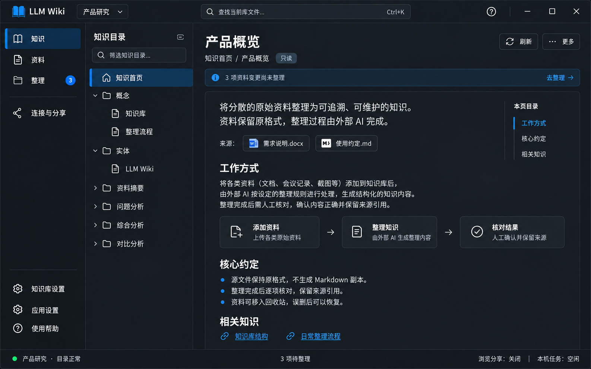

# 页面01｜知识：阅读与来源追溯

## 1. 目标、入口与概念图

默认阅读当前库生成的知识，理解分类、查看来源、进入整理。主导航“知识”；全局文件名搜索结果也可打开指定文档。页面不提供聊天和资料上传，不把系统文件当知识正文。

图示为深色、已生成知识、选中知识首页、3项待整理的正常阅读状态。目录正文应可读，焦点移到正文后仍保留目录选中。此页详细规格连同 [总体约定](../00_总体架构与实现约定.md) 为实现依据。

## 2. 区域、控件与尺寸

| 区域 | 基础控件/项目组件 | 尺寸和责任 |
|---|---|---|
| 目录 | 项目KnowledgeTree；缺失用ui:TreeView、ui:TextBox、SymbolIcon | 宽248，可拖220—320；树行36、图标16、缩进20 |
| 分栏 | wpf:Grid + GridSplitter | 导航外再分目录和阅读，不套两层完整页面 |
| 标题区 | TextBlock、轻量Badge、Button、DropDownButton | 标题26，路径12—13；只读徽标；刷新与更多 |
| 待整理提示 | ui:InfoBar或同规范轻提示 | 只显示源变更数量与去整理，不在本页确认清单 |
| 阅读 | 项目MarkdownPreview/DocumentWorkspace；缺失用FlowDocumentScrollViewer承载解析结果 | 一张阅读表面，内部32留白；正文优先680—820宽 |
| 来源 | ItemsControl + 项目SourceLink/HyperlinkButton | 原名标签、真实关联，未知不猜跳转 |
| 本页目录 | ItemsControl/ListBox + HyperlinkButton | 144—160宽；阅读区不足900宽时折成菜单 |
| 手动修订 | 已有编辑器或多行ui:TextBox | 高级入口才进入，复用保存/冲突保护 |

WPF-UI本身不解析Markdown；FlowDocument中的Run、链接、表格与代码也须绑定主题资源。不能因选择TreeView就保留其未配置的黑字/白色选中模板。

## 3. 页面样式

整窗按总体52/208/28布局。阅读标题只出现一次：无独立大标题“知识”，无index文件头卡再叠正文文件头。标题优先首个可解析H1，否则文件名去后缀；渲染中仅省略同一个重复H1，不修改磁盘文件。

目录正常使用ItemText，选中底深色#174B72/浅色#D9EDFF，选中文字/图标#FFFFFF/#102A43，左3DIP指示条。Hover不盖Selected，正文获得焦点后蓝底不消失；键盘Focus另叠2DIP边框。展开箭头、子项、命中高亮都不能写死黑色。

阅读底ReadingSurface，1DIP Stroke、圆角8；正文14—15、行距23—25，H2为18上24下10，段距12，列表间6—8。代码块等宽、12内边距，可复制；代码和宽表格局部横滚，不让整页横滚。大段正文不全加粗、不每段套卡片。

只读显示“只读”，不显示“已保存”。复制路径、打开文件夹和手动修订放更多菜单，主标题区不堆四五个按钮。未知来源不画可用蓝色链接；缺失来源附“来源已移除”，让用户知晓而非静默隐藏。

## 4. 数据、状态与命令

VM按目录、当前阅读、来源、页内标题、手动草稿分块：TreeNodes、SearchKeyword、SelectedPath、ExpandedPaths；DocumentTitle、RelativePath、Content、LoadedVersion、IsLoading、LoadError；SourceLinks、HeadingItems；EditContent、OriginalContent、SaveState。它们不放进全局大state。

| 命令 | 可执行条件 | 持久影响/下一步 |
|---|---|---|
| Load/RefreshTree | 库可访问；草稿保护已通过 | 保留展开/选择；请求带库版本 |
| SelectKnowledge | 目标在库内、旧草稿已解决 | 异步读明确路径；过期响应丢弃 |
| FilterTree | 当前目录已加载 | 文件/目录名过滤，保留父链，不宣称全文检索 |
| OpenSource | 有可靠源映射且文件存在 | 转资料页并定位，仍执行离开保护 |
| GoToHeading | 标题解析成功 | 正文滚动、目录当前项同步 |
| GoToOrganize | 库可用 | 转整理页当前库，不重复选择 |
| BeginManualEdit | wiki授权文本且非日志/系统文件 | 显示保护说明，进入原位编辑 |
| SaveManualEdit | Dirty、非Busy、权限与版本有效 | 精确路径写回，记日志与人工保护，不登记源变更 |

## 5. 正常流程与特殊状态

1. 首次选中index，缺失尝试overview；只有初始模板骨架且无其他知识页时显示“还没有整理出的知识”，有资料提供“开始整理”，无资料提供“添加资料”。存量未知模板保守展示，不猜测清空。
2. 点树节点读取；刷新目录恢复展开与选择。文件消失则清正文并提示，读取失败展示错误+重试，不当空库。
3. Wikilink解析为库内目标；同名歧义列候选，目标缺失标明。目录中文别名不改磁盘路径：实体entities、概念concepts、资料摘要sources、问题分析queries、综合分析synthesis、对比分析comparisons。
4. 来源标签使用真实文件名，映射不到只显示引用。内页目录由标题生成，不做固定装饰列表。
5. 更多→手动修订，保存成功继续编辑，可完成编辑回阅读。未改保存禁用；失败保留草稿；磁盘冲突提供磁盘版本/另存/返回。
6. 手动修订记录当前路径/哈希保护；MCP命中保护返回MANUAL_REVIEW_REQUIRED。解除仅针对用户核实版本；文件直读Agent只能通过任务约定提醒，不能声称技术拦截。

无结果过滤显示清空入口；加载区域保留可辨旧内容并标刷新；大树异步/虚拟化，不外包ScrollViewer破坏虚拟化。图片和外链仅按现有安全解析能力，不引入WebView2。

## 6. 实现步骤与注意项

1. 映射现有阅读器和树控件，先打通真实树/路径/内容与空错状态。
2. 完成树容器与Header模板的普通/选中/失焦/焦点，再接统一主题；通过后迁入页面。
3. 统一单标题结构、来源和页内目录，去掉只读保存状态；实现按比例阅读而非空大编辑框。
4. 实现全部导航保护、外部变化刷新和高级修订版本保护。
5. 按图同尺寸截图，比较布局边界、字体、层级与选中态；不能拿模板文件代替真实知识回归。

## 7. 本页验收

- [ ] 与单页图同风格与主比例，单一标题、正文层次清楚，无只读“已保存”。
- [ ] 深浅主题树文字/图标/箭头、选中失焦与键盘焦点可读。
- [ ] 分类别名、搜索父链、链接歧义、来源跳转使用真实路径。
- [ ] 默认模板空状态、文件缺失和访问错误均可解释。
- [ ] 手动修订精确写回并保护人工版本，失败/冲突不丢草稿。
- [ ] 1180与1100宽度收起页内目录后核心阅读可达，长表格局部滚动。

## 8. 弹框、通知与页内反馈

共用尺寸/焦点/按钮顺序按 [总体反馈规范](../00_总体架构与实现约定.md)。默认阅读、选树、刷新、来源跳转、进入整理不弹成功框；加载失败就在阅读区显示原因与重试，不逐次弹“读取失败”。

| 场景 | 反馈形式与文案 | 操作与关闭行为 |
|---|---|---|
| 手动编辑后离开 | D02未保存框，列当前路径 | 保存并继续/放弃更改/留在此处；保存失败留原框和草稿 |
| 磁盘版本已变化 | 共用D04，在当前编辑流程内显示“文件已被其他程序修改” | 查看磁盘版本/另存副本/返回编辑；已有D02时原框切子视图，不叠框 |
| 保存人工修订成功 | N01“{知识页名} 已保存”+编辑区已保存状态 | 继续编辑，完成编辑回只读；不说源资料已同步 |
| 进入手动修订 | 阅读区轻InfoBar“手动修改不会更新源资料，后续整理需核对人工内容” | 原位进入，不弹介绍确认；只在发生保护解除/覆盖决策时弹 |
| 目标链接不存在/来源已移除 | 链接附近文字或阅读区提示 | 提供返回/去整理，不弹全局错误框 |
| Wiki同名链接歧义 | 锚点候选Flyout，列候选相对路径 | 点选打开，Esc/点外收起；不改变未选文档 |
| 有待整理/规则更新 | 标题下持久InfoBar，显示真实数量/版本说明 | 去整理/稍后处理；关闭提示不清变更或认定规则已完成 |

**D15 解除人工保护**：由用户明确点击受保护文件的“解除当前版本保护”触发，520宽。标题“允许后续任务修改此知识页？”；正文“将解除‘{文件名}’当前人工修订版本的保护。后续AI写入仍需满足路径与版本校验，源资料不会改变。”显示相对路径与版本摘要。按钮取消/解除当前版本保护，初焦取消；只解绑本次显示的版本，不一并解除全库。提交中禁重复，版本已变化则留框显示“文件已有新变化，请重新核对”，不解除新版本。成功关闭并短提示“已解除当前版本保护”，人工保护状态同步刷新。

本页额外验收：D02/D04无叠框、Esc不丢草稿；D15针对精确文件版本；只读页没有保存成功Toast；来源丢失和刷新错误不抢焦点或连续弹窗。
