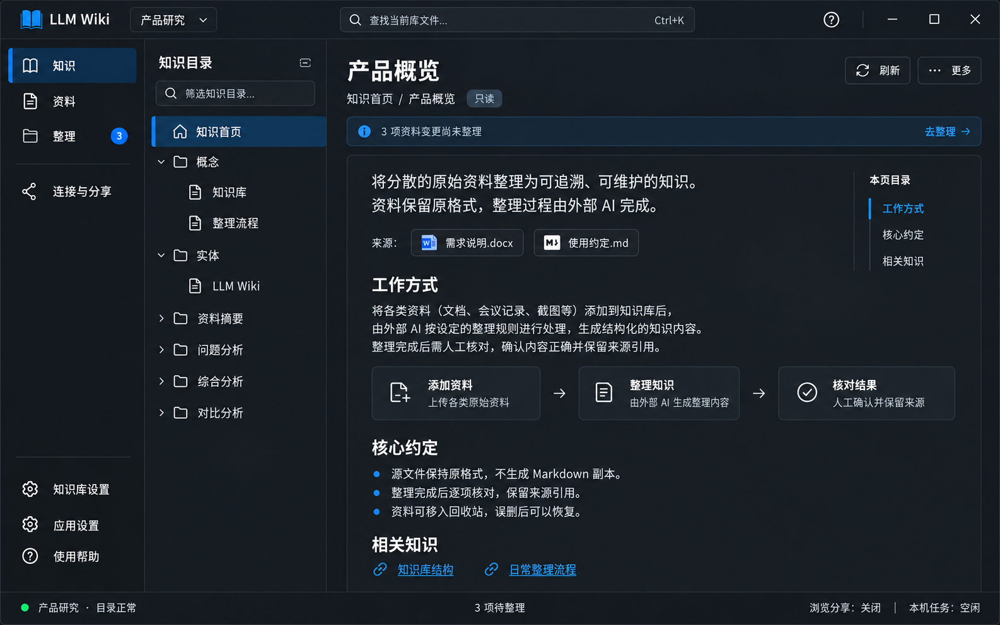

# 页面01｜知识：源文档入口与知识阅读

## 1. 目标、入口与概念图

用户只关心源文档；知识结构由 AI 维护。页面默认只展示当前库的源文档（`raw/sources/`），点开只读预览；需要查看 AI 生成的知识结构时打开"显示结构文件"开关阅读 wiki 树。主导航"知识"；全局文件名搜索结果也可打开指定文档。页面不提供聊天、资料上传与任何编辑入口，不把系统文件当知识正文。

图示为深色、已生成知识、选中知识首页、3项待整理的正常阅读状态。目录正文应可读，焦点移到正文后仍保留目录选中。此页详细规格连同 [总体约定](../00_总体架构与实现约定.md) 为实现依据。

## 2. 区域、控件与尺寸

| 区域 | 基础控件/项目组件 | 尺寸和责任 |
|---|---|---|
| 目录 | 项目KnowledgeTree；缺失用ui:TreeView、ui:TextBox、SymbolIcon、ui:ToggleSwitch | 宽248，可拖220—320；树行36、图标16、缩进20；标题下"显示结构文件"开关 |
| 分栏 | wpf:Grid + GridSplitter | 导航外再分目录和阅读，不套两层完整页面 |
| 标题区 | TextBlock、轻量Badge、Button | 标题26，路径12—13；只读徽标；刷新与更多 |
| 待整理提示 | ui:InfoBar或同规范轻提示 | 只显示源变更数量与去整理，不在本页确认清单 |
| 阅读 | 项目MarkdownPreview/DocumentWorkspace；缺失用FlowDocumentScrollViewer承载解析结果 | 一张阅读表面，内部32留白；正文优先680—820宽 |
| 来源 | ItemsControl + 项目SourceLink/HyperlinkButton | 原名标签、真实关联，未知不猜跳转 |
| 本页目录 | ItemsControl/ListBox + HyperlinkButton | 144—160宽；阅读区不足900宽时折成菜单 |

WPF-UI本身不解析Markdown；FlowDocument中的Run、链接、表格与代码也须绑定主题资源。不能因选择TreeView就保留其未配置的黑字/白色选中模板。

## 3. 页面样式

整窗按总体52/208/28布局。阅读标题只出现一次：无独立大标题"知识"，无index文件头卡再叠正文文件头。标题优先首个可解析H1，否则文件名去后缀；渲染中仅省略同一个重复H1，不修改磁盘文件。

目录正常使用ItemText，选中底深色#174B72/浅色#D9EDFF，选中文字/图标#FFFFFF/#102A43，左3DIP指示条。Hover不盖Selected，正文获得焦点后蓝底不消失；键盘Focus另叠2DIP边框。展开箭头、子项、命中高亮都不能写死黑色。

阅读底ReadingSurface，1DIP Stroke、圆角8；正文14—15、行距23—25，H2为18上24下10，段距12，列表间6—8。代码块等宽、12内边距，可复制；代码和宽表格局部横滚，不让整页横滚。大段正文不全加粗、不每段套卡片。

只读徽标恒为"只读"，不存在编辑态与保存状态文本。复制路径、打开文件夹和解除保护放更多菜单，主标题区不堆四五个按钮。未知来源不画可用蓝色链接；缺失来源附"来源已移除"，让用户知晓而非静默隐藏。

## 4. 数据、状态与命令

VM按目录、当前阅读、来源、页内标题分块：TreeNodes、SearchKeyword、SelectedPath、ShowHiddenFiles、ExpandedPaths；DocumentTitle、RelativePath、Content、IsLoading、LoadError；SourceLinks、HeadingItems。它们不放进全局大state。本页 Workspace 恒定 EditSuppressed=true，源文档预览不出现编辑按钮。

| 命令 | 可执行条件 | 持久影响/下一步 |
|---|---|---|
| Load/RefreshTree | 库可访问 | 保留展开/选择；请求带库版本 |
| SelectKnowledge | 目标在库内 | 异步读明确路径；过期响应丢弃；wiki/ 走知识只读，raw/sources/ 走源文档只读预览（md/txt 直读、图片解码、docx/pdf 提取文本） |
| ToggleShowHidden | 用户切换开关 | 目录栏追加/收起 wiki 结构树；偏好写入应用配置记忆 |
| FilterTree | 当前目录已加载 | 文件/目录名过滤，保留父链，不宣称全文检索 |
| OpenSource | 有可靠源映射且文件存在 | 转资料页并定位 |
| GoToHeading | 标题解析成功 | 正文滚动、目录当前项同步 |
| GoToOrganize | 库可用 | 转整理页当前库，不重复选择 |

## 5. 正常流程与特殊状态

1. 默认目录只列源文档（`raw/sources/` 顶层文件，按名称排序）；打开"显示结构文件"后追加 wiki 树（index.md 置顶显示"知识首页"，目录中文别名：实体entities、概念concepts、资料摘要sources、问题分析queries、综合分析synthesis、对比分析comparisons）。展开状态在切换开关/刷新时保留。
2. 打开 index，缺失尝试overview；wiki 只有初始模板骨架且无其他知识页时显示"还没有整理出的知识"，有资料提供"去整理"，无资料提供"去资料页"。空态覆盖层在用户从目录点开任一文件后让位正文。
3. 点树节点读取；刷新目录恢复展开与选择。文件消失则清正文并提示，读取失败展示错误+重试，不当空库。
4. Wikilink解析为库内目标；同名歧义列候选，目标缺失标明。别名不改磁盘路径。
5. 来源标签使用真实文件名，映射不到只显示引用。内页目录由标题生成，不做固定装饰列表。
6. 人工修订保护机制保留：MCP命中受保护版本返回MANUAL_REVIEW_REQUIRED。解除仅针对用户核实版本（更多→解除本页人工修订保护）；知识页本身不再产生新保护——产生保护的编辑入口已移除，wiki 一律由 AI 维护。

无结果过滤显示清空入口；加载区域保留可辨旧内容并标刷新；大树异步/虚拟化，不外包ScrollViewer破坏虚拟化。图片和外链仅按现有安全解析能力，不引入WebView2。

## 6. 实现步骤与注意项

1. 映射现有阅读器和树控件，先打通真实树/路径/内容与空错状态。
2. 完成树容器与Header模板的普通/选中/失焦/焦点，再接统一主题；通过后迁入页面。
3. 实现源文档默认目录 + "显示结构文件"开关（偏好持久化到应用配置），源文档节点与 wiki 树共用同一虚拟化树。
4. 统一单标题结构、来源和页内目录；按路径前缀分流打开逻辑（wiki/ 知识只读、raw/sources/ 源文档只读预览），Workspace 抑制编辑按钮。
5. 按图同尺寸截图，比较布局边界、字体、层级与选中态；不能拿模板文件代替真实知识回归。

## 7. 本页验收

- [ ] 与单页图同风格与主比例，单一标题、正文层次清楚。
- [ ] 默认目录只显示源文档；打开"显示结构文件"后 wiki 树出现，开关偏好重启保留。
- [ ] 源文档点开为只读预览（文本/图片/文档提取），无编辑按钮；wiki 页只读，无任何编辑入口。
- [ ] 深浅主题树文字/图标/箭头、选中失焦与键盘焦点可读。
- [ ] 分类别名、搜索父链、链接歧义、来源跳转使用真实路径。
- [ ] 默认模板空状态、文件缺失和访问错误均可解释；点开文件后空态让位正文。
- [ ] 1180与1100宽度收起页内目录后核心阅读可达，长表格局部滚动。

## 8. 弹框、通知与页内反馈

共用尺寸/焦点/按钮顺序按 [总体反馈规范](../00_总体架构与实现约定.md)。默认阅读、选树、刷新、来源跳转、进入整理不弹成功框；加载失败就在阅读区显示原因与重试，不逐次弹"读取失败"。

| 场景 | 反馈形式与文案 | 操作与关闭行为 |
|---|---|---|
| 目标链接不存在/来源已移除 | 链接附近文字或阅读区提示 | 提供返回/去整理，不弹全局错误框 |
| Wiki同名链接歧义 | 锚点候选Flyout，列候选相对路径 | 点选打开，Esc/点外收起；不改变未选文档 |
| 有待整理/规则更新 | 标题下持久InfoBar，显示真实数量/版本说明 | 去整理/稍后处理；关闭提示不清变更或认定规则已完成 |

**D15 解除人工保护**：由用户明确点击受保护文件的"解除当前版本保护"触发，520宽。标题"允许后续任务修改此知识页？"；正文"将解除'{文件名}'当前人工修订版本的保护。后续AI写入仍需满足路径与版本校验，源资料不会改变。"显示相对路径与版本摘要。按钮取消/解除当前版本保护，初焦取消；只解绑本次显示的版本，不一并解除全库。提交中禁重复，版本已变化则留框显示"文件已有新变化，请重新核对"，不解除新版本。成功关闭并短提示"已解除当前版本保护"，人工保护状态同步刷新。存量保护来自旧版本的手动修订；新版本不再产生新保护。

本页额外验收：D15针对精确文件版本；只读页没有保存成功Toast，无编辑快捷键；来源丢失和刷新错误不抢焦点或连续弹窗。
