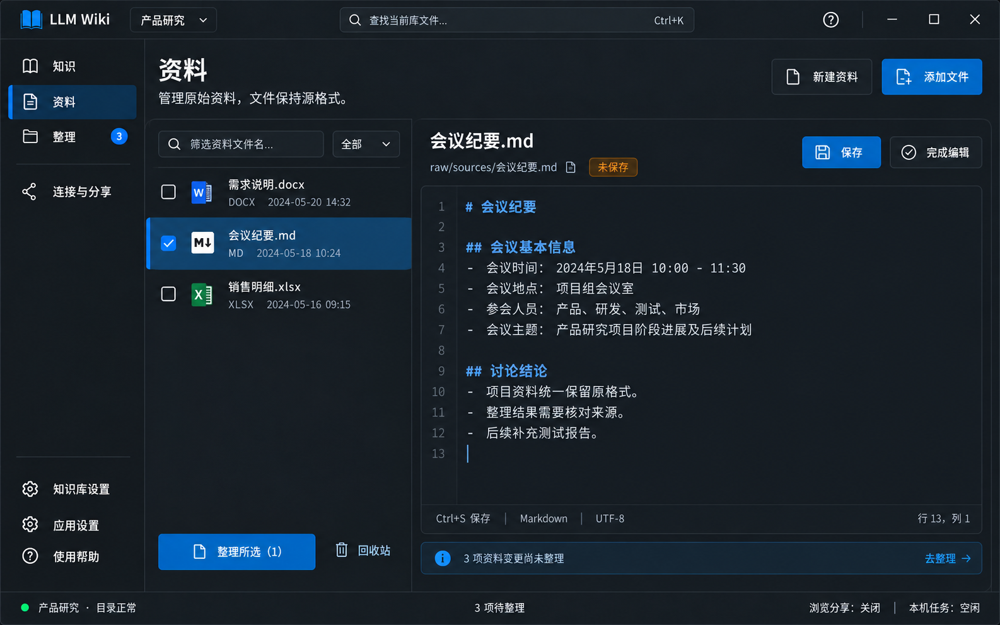

# 页面02｜资料：添加、编辑、整理入口与回收站

## 1. 目标、入口与概念图

管理当前库的原始输入，保存与知识更新分开。支持PDF、Word、电子表格、PPT、结构化数据、文本与常见图片，完整扩展名以[总体格式表](../00_总体架构与实现约定.md)第3.1节为准；上传保持原格式，不生成Markdown副本。主导航“资料”；知识来源链接可定位本页文件。

图示是会议纪要.md原位编辑且未保存，左侧一项被选用于整理；Office文件保持原名。图不是Office转换预览，不代表所有格式能在应用内编辑。

## 2. 区域、控件与样式

| 区域 | 控件/组件 | 样式与责任 |
|---|---|---|
| 页头 | TextBlock、Button、DropDownButton | 标题26；新建资料次按钮、添加文件主按钮；少量说明 |
| 资料列表 | 项目SourceList；ui:ListView或DataGrid | 左宽300—340、可拖；文件名14，元信息12，行52 |
| 筛选 | ui:TextBox、ComboBox | 文件名过滤；类型为全部/文档/表格/演示/PDF/文本/数据/图片，注册表统一映射；列表数真实 |
| 选择 | ui:CheckBox + SelectedItems | 勾选与单击预览分开，筛选外已选数可见 |
| 编辑 | DocumentWorkspace + 原有编辑器，缺失用多行TextBox | 单标题/路径、保存状态、保存/完成编辑；编辑填满右侧 |
| 原格式信息 | SourceFilePreview + Card/Border/SymbolIcon/Buttons | 显示原名/格式/大小与预览、编辑、AI读取状态；格式切换正文模板，始终保留打开/导出 |
| 文档/PDF/PPT内容 | 现有预览组件优先；FlowDocumentScrollViewer、ComboBox、Button | 只读内容、页/幻灯片定位、读取范围与未提取内容；不宣称版式完整复刻 |
| 表格预览 | 现有表格预览；wpf:DataGrid、ComboBox、分页按钮 | 工作表/分隔符选择、行列范围；只读、虚拟化，两主题覆盖表头/行/单元格/滚动条 |
| 数据/图片预览 | DocumentWorkspace或Image+ScrollViewer | JSON等按原文；图片缩放、尺寸/帧信息，无法解码回原件卡 |
| 处理结果 | InfoBar + 分项列表 | 文件保存阶段、失败原因、重试，不伪造百分比 |
| 回收站 | 页内SourceRecycleBin + DataGrid/Buttons | 从更多菜单打开；不是新主导航 |

布局左右距24，列距16；列表和正文独立滚动。编辑区只一层CardSurface，圆角8、描边1，内距16—24；控件高32—36。列表选中深#174B72/浅#D9EDFF及完整前景/图标，失焦仍保留。DataGridCell不得覆盖Row主题。未保存用图标+文字，不能仅黄点。

编辑正文等宽，当前状态不虚构语法高亮/行号能力；已有编辑器支持才接。错误保留编辑内容，输入附近显示原因。只读Office按钮用“打开原文件”，不提供文本框保存docx二进制。

每个文件显示三个独立能力状态：“已入库”“预览可用/需外部打开”“本次AI已验证/未验证/不可读取”；不使用一个“已支持”徽标覆盖所有含义。当前概念图展示Markdown编辑态，新增格式复用相同左右工作区及下列正文模板，无需另增导航或上传向导。

## 3. 数据分块与命令

资料查询参数只含当前列表筛选；Files、SelectedFile、SelectedSourceIds、IsLoading、LoadError、UploadResults独立。工作区独立EditContent/OriginalContent/FileVersion/SaveState。回收列表和恢复状态独立，不能与活动文件列表共用选中项。

| 命令 | 可执行条件 | 完成效果 |
|---|---|---|
| AddFiles | 库可写，无冲突未决；运行中所选源不被覆盖 | 系统多选→逐项原字节保存→记录变更→列表与徽标刷新 |
| CreateSource | 合法不重复md/txt名、可写 | 初次保存才建文件；成功选中，不先造空文件 |
| Select/BeginEdit | 旧草稿已解决；格式允许文本编辑、编码明确且不超过1MiB | 加载真实版本，预览转原位编辑；其余提供打开原文件 |
| Save | Dirty、非Busy、版本/权限有效 | 精确路径替换、变更/日志可靠登记、继续编辑 |
| OpenOriginal | 文件存在且非受限路径 | 系统关联程序；无关联提示选择程序/导出 |
| ExportSource | 文件可读 | 内容与源字节一致，不隐式转码 |
| OrganizeSelected | 至少选一且库可用 | 带相对路径和库身份进整理，范围=所选资料 |
| MoveToTrash | 草稿解决、可写、无本机任务正在使用该源 | 移入隐藏回收站，撤销可用，记录删除变更 |
| Restore | 条目完整、库可写、目标合法 | 空位原位恢复；冲突另存，不静默覆盖 |

## 4. 添加与同名覆盖流程

1. 系统多选过滤为“所有支持的资料”及文档/表格/演示/PDF/文本/数据/图片分组；扩展集合来自总体注册表。逐文件校验名称/大小/扩展及可用类型特征，冲突先统一D03再提交；单文件20MiB，多选按文件提交，传输封装开销另计。预览器不存在不阻止合法原件入库，不支持类型逐项说明，不宣称任意格式都支持。
2. 显示等待/保存中/已添加/已跳过/失败；无可测百分比用阶段。存储、预览、读取能力是独立状态；预览失败不误报上传失败。
3. 同名列冲突范围，选覆盖/跳过/返回；覆盖前把旧字节存回收站“覆盖前版本”，无法安全保留则拒绝覆盖。
4. 临时完整写入与校验后提交，不留半文件；提交后补记录。已保存但记录失败提示重试登记，不要求重复上传；按总体operations恢复。
5. 展示真实分项结果，“整理新增资料”携带成功的目标；失败项可重试，不自动执行AI。

上传不重编码、不写raw/original、不生成.docx.md/.pdf.md/.pptx.md。一份原格式资料计一份；页数、工作表和幻灯片不增加源文件计数。历史原件/派生物按可靠映射兼容，不自动清理。JSON资料与应用隐藏JSON状态不混为同一读写范围。

### 4.1 各格式的预览交互

| 格式 | 右侧工作区与具体细节 |
|---|---|
| PDF | 页码输入/前后页、文字预览与覆盖说明；无可提取文字显示“此页可能为扫描内容，需要视觉读取或OCR”，打开原文件始终可用；不把空提取结果显示为文件为空 |
| Word | DOCX/DOCM预览段落/标题/表格，明确“内容预览”；图片、批注、修订等未覆盖部分列出。其他文档格式无已验证读取器时显示原件卡、原因与打开，不要求转MD |
| 表格 | XLSX/XLSM工作表选择、真实行列号、只读虚拟网格；首批最多200行/50列，可继续加载/切范围。显示公式与缓存值的区别，不运行公式或宏、不隐式刷新外部数据；缺缓存值说明。合并单元格/隐藏表与行列的处理范围明确 |
| CSV/TSV | 编码/分隔符/表头设置仅影响预览，不写回；正确处理引号、单元格内换行与空值，保留前导零/长数字。切原文后编辑，不把网格重排重新导出覆盖源文件 |
| PPT | PPTX/PPTM真实幻灯片序号列表、当前页文字、可展开备注，隐藏页有标识；图形/图表/图片/动画未读取要说明。PPT等旧格式无读取器时用原件卡，不假装已读全部演示文稿 |
| JSON等数据 | 原文为默认视图；JSONL按行定位，语法问题就地提示，不自动格式化、修复、排序或执行。树形/格式化只能是已有组件提供的只读查看模式，不能改变保存原文 |
| 图片 | 支持的解码器显示等比例图、缩放/还原、尺寸/帧信息，保留原色；不把图片显示出来等同OCR已成功。WEBP/SVG/多帧等能力不足时显示原因并打开原件 |

所有解析异步，切文件后迟到结果不得覆盖新文件；读取超时/受保护/损坏/预算不足在本区域反馈。预览部分内容必须标范围与继续入口，不用加载完成误称全文已覆盖。

## 5. 新建、编辑与外部修改

新建菜单Markdown/纯文本，默认md；在右侧输入文件名和正文，缺后缀按类型补，非法/重名就地报错。创建失败保留文件名和正文。源文本选中默认预览，点编辑转原位；预览/编辑不走小模态窗口。

JSON/JSONL/XML/YAML/TOML/INI/LOG及CSV/TSV可在1MiB以内按原文编辑，其他文本超限只读分段预览并提供系统打开。编码由BOM或可靠检测确定，保留原编码/BOM/换行；编码不明先只读并提供选择，不能猜错后覆盖。语法校验与文件保存分开：上传不因JSON语法无效而改内容，编辑时保留草稿并就地提示；用户明确点行内“仍按原文保存”可保存当前原文，不自动修复、不另开确认框。没有校验器则显示未校验。新建菜单仍只提供Markdown/纯文本，不伪造新建Office能力。

| 保存状态 | 行为 |
|---|---|
| 未修改 | 保存禁用，Ctrl+S不写盘、不制造待整理 |
| 未保存 | 保存启用；切文件/页/库/关闭走统一保护 |
| 保存中 | 防重复、锁定路径，等待结果后再执行离开意图 |
| 已保存 | 更新原缓冲与版本，留编辑；完成编辑回预览 |
| 保存失败 | 草稿保留，原因+重试；不清空或关编辑器 |
| 外部版本冲突 | 不覆盖，磁盘版本/另存/返回编辑 |

Office、PDF编辑器或其他系统程序保存后，回到应用刷新扫描原字节变化；文件监测只触发扫描，启动也能检测关闭期间变化。~$锁文件不入库；读取中不稳定标正在保存；断网不判删除。应用内本机任务运行时所选源禁止修改，外部仍可能变更，整理确认需再次比版本。

## 6. 选择与整理跳转

点击行预览，复选框勾选用于整理/回收，二者不互相冒充。过滤后保留勾选并显示“已选5项，其中2项被筛选隐藏”；批量操作前范围始终可见，不能默默只删可见项或全选隐藏项。切库清空本页选择。

整理所选带库上下文与稳定相对路径，不要求再填逗号名。跳转时缺失项提示可移除缺失项继续；删除项从整理的待整理范围处理，不能假装仍存在的源资料。

## 7. 可恢复删除完整规则

普通按钮“移入回收站”，草稿先解决；可恢复移除不再额外确认，成功Snackbar“已移入回收站，可恢复”+撤销。失败保留源文件，不自动降级永久删除。

隐藏 `.llmwiki/trash/<id>/` 保存原字节和元信息：原相对路径、哈希、大小、时间、原因、操作/变更关联。先写凭据，安全保存后移除源路径；本地与UNC同机制，不依赖Windows回收站。中断用两端哈希与凭据恢复，只有元数据不能显示为可恢复。

回收站不进源计数、搜索、整理、扫描、MCP或浏览分享；回收文件存在不妨碍活动路径被判删除。保留至用户手动清理，显示大小，不到期自动删。导出可保留原件，永久删除/清空列数量大小并一次危险确认；失败分项说明。

| 恢复情形 | 变更处理 |
|---|---|
| 空闲原路径，同哈希，相关清理未生成/复制且删除未确认 | 仅稳定关联/版本仍匹配时撤销这次删除标记，恢复删除前未处理状态 |
| 已复制清理或可能执行、删除已确认 | 原删除任务失效；恢复源登记待重新核对，知识可能已清理 |
| 同名占用、选择另存/内容不同 | 不覆盖；按真实路径新增/修改，不清无关删除项 |
| 映射不明或后续已有新变化 | 保守保留变更并提示核对，不凭同名清记录 |

撤销与恢复同一服务，同样检查后来冲突。恢复资料不自动恢复Wiki；回收站不是备份，永久删库会同时删回收站。Wiki页删除仍由维护计划和本机明确确认，不扩大MCP删除权限。

## 8. 实现步骤与页内验收

先真实文件清单与版本读取 → 原格式上传与覆盖前版本 → 工作区保存/冲突/离开 → 选择到整理 → 回收移入/恢复/永久清理 → 深浅状态与图比对。

- [ ] 图示未保存态与实际行为一致，Ctrl+S成功留编辑，失败不丢草稿。
- [ ] 上传/导出字节哈希一致，无MD衍生文件；大小限制与部分失败真实。
- [ ] 选中失焦、复选框、单元格、筛选外选择在两主题都清楚。
- [ ] 系统Office编辑后刷新检测到变更，临时锁文件和断网不造成假项。
- [ ] 回收、同名恢复、清理任务后恢复、覆盖前版本与断线恢复均通过。
- [ ] 添加/保存成功但记录失败能够补记，不通过重复上传或清空清单掩盖。

## 9. 弹框与通知的具体设计

共用视觉/焦点/Busy规则见 [总体反馈规范](../00_总体架构与实现约定.md)。新增文本在右侧编辑，不弹主编辑器；添加文件使用系统选择器；移入回收站不再弹一次删除确认。

### 9.1 本页决策框

| ID/触发 | 标题、内容与输入 | 按钮与默认焦点 | 提交/失败行为 |
|---|---|---|---|
| D02 切文件/页/库、取消编辑 | 还有未保存的更改；列真实文件名/路径 | 放弃更改 / 留在此处 / 保存并继续；初焦留在此处 | 按总体D02；保存失败留框，离开意图只执行一次 |
| D03 多选上传遇重名 | “发现 {n} 个同名文件”；640宽，列表列文件名、现有大小/时间、此次大小。说明覆盖前版本将保留到回收站，待整理需更新 | 取消本批 / 跳过同名继续 / 覆盖同名继续；初焦跳过同名继续，覆盖用危险样式 | 提交前不先上传一半；明确非冲突项会继续添加。范围改变重新核对；不能保留旧版本则该项失败保留原件，分项结果回页内，不叠错误框 |
| D04 保存发现磁盘版本变化 | “文件已被其他程序修改”；640宽，文件与相对路径，编辑开始版本/磁盘版本时间，说明你的编辑内容已保留 | 返回编辑 / 查看磁盘版本 / 另存副本；初焦返回编辑 | 查看版本在当前框子视图或编辑区只读对照，不能覆盖草稿；另存在同框输入合法新名称，保存到允许资料目录。已在D02内则原位冲突子状态，不叠框 |
| D05 恢复遇同名 | “原位置已有同名文件”；520宽，列回收文件和当前占用路径，预填可用的“原名（恢复1）.扩展名” | 取消 / 另存恢复；初焦新名称输入，保留扩展名 | 即时校验，提交前重查存在性，仍冲突留框；本版不提供恢复直接覆盖，不为了恢复再问覆盖一次 |
| D06 永久删除/清空回收站 | “永久删除 {n} 项？”/“清空回收站？”；520或640宽，数量、大小、文件列表摘要，说明“删除后无法通过本应用恢复” | 取消 / 永久删除这 {n} 项；初焦取消，主动作危险样式 | 只删明确选中的快照范围。执行中防重复；部分失败在同框显示保留项与原因，可重试失败项，不能报全成功；成功关闭并刷新回收占用 |

D04不出现“直接覆盖磁盘文件”主按钮；另存失败保留新名称和草稿。系统选择器与应用决策框不并行，批量冲突只用一次D03，不为每份文件弹一次。

### 9.2 轻通知与页内状态

| 事件 | 反馈与位置 | 后续 |
|---|---|---|
| 文本保存成功 | N01“{文件名} 已保存”，3秒；编辑区改为已保存 | 继续编辑；有源变更时页头提供去整理，不自动执行 |
| 文件已保存但变更/日志登记失败 | 编辑区/上传结果上方持久警告“文件已保存，变更记录未完成” | 重试登记/查看文件；解决后移除，不要求重新上传 |
| 添加一批结束 | 页内结果列表持久显示已添加/跳过/失败；只发一次汇总 | 有失败用警告摘要“已添加3份，失败1份”，提供查看结果；逐项重试，不逐文件Toast轰炸 |
| 添加/预览/读取失败 | 目标行/正文区域就地错误，格式/权限等原因具体 | 预览失败不改添加成功事实；打开原文件/重试 |
| 移入回收站成功 | N03“已移入回收站，可恢复”，8秒，撤销 | 不另确认；撤销走真正恢复服务，时限后仍可从回收站恢复 |
| 恢复成功 | 成功3秒“已恢复：{实际恢复文件名}” | 显示真实另存名称；若知识已清理，页内提示需要重新整理 |
| 外部编辑变化/扫描不完整 | 页头持久说明或对应行状态 | 去整理/重试扫描；扫描不完整不逐个弹“文件删除” |
| 复制路径/导出成功 | 短通知，导出说明真实目标 | 系统导出取消不发错误Toast；复制失败N04式重试 |

Snackbar关闭只关闭提示，不取消已落盘保存、不会永久清理回收条目；撤销命令绑定条目ID/版本，同名冲突转D05，不能使用当前SelectedFile恢复错对象。

### 9.3 本页反馈验收

- [ ] 一批同名只一个D03，取消本批不产生隐式半批写入；覆盖前版本保留失败不破坏原件。
- [ ] D04可返回/查看/另存，已有未保存框时不再叠框；草稿始终保留。
- [ ] N03时限、悬停暂停、撤销与同名D05真实；提示过期不使恢复入口消失。
- [ ] D06明确永久性、数量/范围与失败项，不把回收当永久删除。
- [ ] 上传汇总、保存成功、补记失败不出现互相矛盾或几十条连续Toast。
