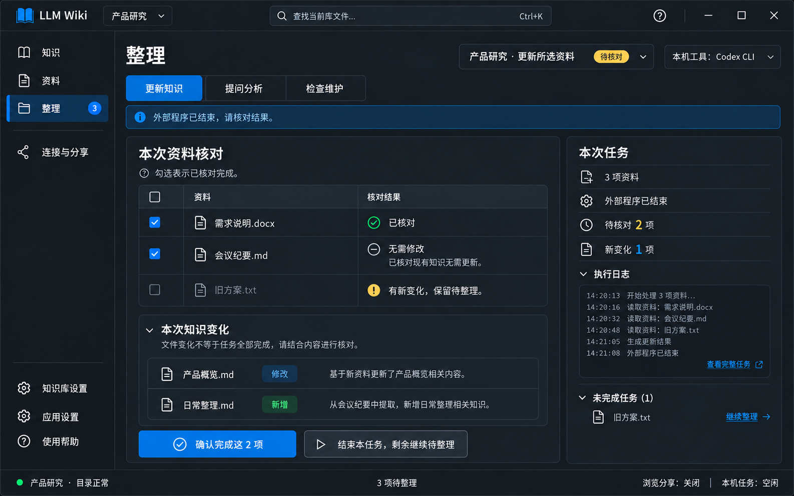

# 页面03｜整理：任务准备、执行与核对闭环

## 1. 目标与概念图

唯一完整维护待整理变更和结果确认的入口。三类任务：更新知识、提问分析、检查维护。资料页/知识页只展示摘要并跳本页，不各自清空变更。不内置聊天。

图示是一个本机执行已结束、尚待用户核对的任务：两项可确认、一项有新变化。右侧是执行摘要，底部一次确认与“结束任务保留剩余”。图中“已结束”不等于已处理全部源变更；主表复选表示人工核对，不是输入文件自动全选。

## 2. 区域控件、尺寸与状态样式

| 区域 | 控件/封装 | 实现要求 |
|---|---|---|
| 任务类型 | ui:TabControl + wpf:TabItem | 三个Tab；正常/选中/失焦标题可读，选中蓝线/背景明确 |
| 准备范围 | ComboBox/RadioButton + PendingChangeList/DataGrid | 待整理/所选/全部，默认待整理不自动勾选；传入所选继承选择 |
| 执行选择 | AgentSelector/ComboBox | 本机/复制/导出入口与文件/MCP访问分开 |
| 预览 | Expander + 只读TextBox | 次入口，完整任务自包含，无令牌，不强制先预览 |
| 运行面板 | AgentRunPanel + InfoBar、ProgressRing、文本行列表 | 真实事件、取消、等待提示，不伪造百分比 |
| 核对主表 | TaskResultReview + DataGrid/CheckBox/行内结论 | 资料级结论、版本状态、原因、勾选后一次提交 |
| 知识变化 | 列表/Expander + HyperlinkButton | 路径、新增/改/删/无变化；只表示准备以来变化 |
| 任务恢复 | 未完成/最近任务折叠列表 | 不新增导航；可继续核对或结束保留剩余 |

页外距24、区块距16；核对主区约65%，执行摘要约35%，小窗口右区下移。表头36、行44—56，名称14、元信息12；标准控件32—36。Row与Cell选中统一底和文字，失焦不变白，禁用项保留可读原因；错误/新变化用文字+徽标，不只红色。

核对面板底部主操作“确认完成这 {n} 项”，次操作“结束本任务，剩余继续待整理”；不以大型彩色按钮并排让人误点。输入范围与核对结果是不同阶段，不能把输入复选框当成用户已核对。

## 3. 数据模型必须分开

| 对象 | 作用 | 完成依据 |
|---|---|---|
| SourceChange | 哪个源版本待整理 | 用户确认且源/记录版本匹配 |
| Task | 本次范围、规则与源快照、核对进度 | 所有项确认，或显式结束保留剩余 |
| Attempt | 本机外部进程状态 | 可靠进程事件与退出，不自动完成源变化 |

导航徽标=当前库未处理源变更条数，页面另有待核对任务数，不把两个数量相加。同一源版本出现在历史任务中不重复计源变化。

VM分块管理Composer、CurrentTask、ReviewRows、KnowledgeChanges、Attempt、SelectedReviewItemIds和独立Busy/Error。每任务持久字段至少taskId、库绑定、类型/范围、规则/模板版本、源快照、Wiki路径/哈希基线、逐项回执和终结原因。

taskItem快照含稳定itemId、相对路径、动作、原记录身份/版本、sourceHash或删除tombstone。日志时间、检查时间和序列化顺序不能改变源身份；不每次扫描随机造ID导致永久冲突。旧记录稳定映射在服务适配，不能改写`.changes.json`结构。

## 4. 更新知识：范围与上下文

| 范围 | 用户使用 | 限制 |
|---|---|---|
| 待整理变更 | 日常新增/修改/删除 | 默认不勾选，提供全选，真实读取记录 |
| 所选资料 | 资料页跳入或本页选文件 | 自动带路径，不再要求逗号输入 |
| 全部资料 | 初次/全量重新核对 | 先明示总数，不称重建、不先清空Wiki |

规则更新独立持久提醒，不伪造成源修改。删除项生成引用清理计划，不读取已删文件；共享实体只摘该来源条目，不整页删除。MCP无删除能力时明示需到本机确认真正删除，不许承诺全自动清理。

每个完整任务自动组合库身份、路径/逻辑资源、目标规则入口及版本、所选源与版本、可读写边界、原格式读取要求、人工修订保护、任务和逐项报告要求。无需先单独粘贴边界说明，不修改用户AGENTS。原格式不能读取/加密/截断须报告并保留项目，不能偷偷转换落盘或忽略。

任务快照增加每个源的具体格式、计划读取方式及所需覆盖范围。PDF页、表格工作表/行列、PPT幻灯片/备注、图片OCR等是文件内定位，不拆成多个源文件，也不能把预览显示200行当整份已经读完。结果行显示已读取范围、遗漏与需要外部处理的原因；加密、需OCR、读取器不支持/未验证不等于无需修改。

准备混合格式任务时，按当前工具+访问方式逐项核对能力。存在未验证/不可读项就在范围区列明，提供“验证所选格式”“仅处理可读资料”“更换工具或访问方式”；用户显式选择子集才冻结该子集快照，其余仍待整理，不悄悄跳过。工具基础Ready不要求全世界格式都通过，但开始本次任务必须满足所选格式，或明确进入外部人工处理分支。人工已在外部完整处理时仍可按既有理由/版本核对闭环，不把未自动验证强行当永远不能确认。

## 5. 准备与执行交互

已配置且能力匹配的本机工具：主按钮“开始整理”；分析/检查用对应动词。无工具或用户选择复制：主按钮“复制整理指令”。外部MCP客户端模式仅“复制任务说明”，MCP本身不派任务；高级菜单“导出任务包”。配置详见 [连接与分享](04_连接与分享.md)。

复制一次完成校验→持久快照→生成→剪贴板；复制失败保留已准备任务，重试同快照，不重复造任务。预览可选；输入/相关版本改变后复制新任务，不覆盖旧快照。已复制只记录copiedAt，不猜外部执行。

本机开始先持久Task/Attempt，再由已验证适配自动传入任务，收真实输出；不能要求用户再去粘贴。运行时可切页/切库阅读，任务仍绑定原库；禁止更换根目录、删执行库、编辑本次源。首版只管理一个本机运行任务，无后台队列；版本仍须防外部变化。

运行输出只读不执行脚本/ANSI，最多最近5000行且1MiB可见文本，较早省略须说明，状态不能跟着丢。10分钟无事件仅提醒，不默认杀进程。取消先请求，5秒未结束提供强制结束归属进程；不误杀其他进程，不把停止读取当成已取消。

已结束/异常/取消均转待核对，不能凭零退出自动确认。异常重启中断待核实，PID需连同启动时间和程序身份核实，不自动重跑；重试只准备当前版本剩余项，不自动回滚已写Wiki。

## 6. 统一任务状态机

| 状态 | 进入事件 | 下一步 |
|---|---|---|
| Prepared 已准备 | 复制/导出/本机运行前快照保存成功 | 复制或运行；“我已在外部执行，核对结果” |
| NeedsReview 待核对 | 人工进入核对；或Attempt结束/失败/取消 | 查看变化、结论、勾选、一次确认 |
| PartiallyConfirmed 部分确认 | 仅本次部分匹配项确认成功 | 继续或结束保留剩余 |
| Confirmed 已确认 | 所有任务项已确认/明确在别处确认 | 历史查看，必要时重新列当前版本待整理 |
| ClosedWithRemaining 已结束仍有未处理 | 用户显式结束且无运行进程 | 归档任务，不清未确认变更 |
| Abandoned 已放弃 | 放弃未执行任务 | 归档，源变更不清除 |

复制/运行是事件或Attempt，不另混进Task主状态。项已变化只是附加标记。全项失效、别处已确认或新任务替代时，仍可归档结束，不让空任务无限挂起。

无外部回调、无Wiki变化、无结构化报告、没先复制或没MCP，都不能阻止打开人工核对。正在写该任务的本机进程未结束时不允许确认。

## 7. 必须接通的命令与CanExecute

| 命令职责 | 输入/条件 | 结果 |
|---|---|---|
| PrepareTask | 库可读、输入有效、可持久化 | taskId与冻结版本，失败不假成功 |
| CopyInstruction | 可用快照、剪贴板可写 | copiedAt或可重试错误，不自动确认 |
| StartLocalRun | 工具Ready、能力/权限匹配、无其他本机运行 | attemptId、真实进程/事件 |
| OpenReview | task存在、无相关正在写进程 | 主动进入NeedsReview，允许零变化 |
| ConfirmItems | 选中至少一项、无重复、库可写、相关扫描完整 | 逐项回执与最新投影 |
| CloseWithRemaining | 未终结、无运行 | 任务归档，所有未确认源变化保留 |
| RequeueCurrentVersion | 当前版本可核实 | 登记当前版本待核对，不回滚文件 |

按钮禁用要说明缺什么，不能永远灰着但无原因。CanConfirm不得要求exitCode=0、报告完整、Wiki必须被改；已知读取失败/未完整读取项默认不选，可在行内“我已用其他方式完整处理”填说明后同一次提交。

## 8. 结果核对与持久确认

知识变化对比准备时与当前wiki清单，显示新增/改/删/无变化，log单独显示不算产出。固定说明“可能包含其他程序修改，不证明均来自本次AI”；重叠任务不猜归属。未备份旧正文，不提供虚假的历史Diff/回滚。

来源解析可关联时展示到源，未知不造。核对行显示源、原动作、版本是否变化、执行报告（可缺）、知识关联和人工结论。无变化可“已核对无需修改”写理由。未经原任务但已外部处理可建立标注用户补充确认的当前快照，不能假装恢复旧执行证据。

勾选表示用户已核对，点“确认完成这n项”一次提交，不再次弹普通确认。服务执行：写确认意图→协调锁内重读源与变更→只移除匹配→保存回执/Task→更新已核对依据→发库状态通知。每项独立返回Confirmed/Changed/Missing-Reappeared/ReadFailed/RecordConflict/AlreadyConfirmed，不能只有一个false。

成功同时刷新清单、导航徽标、知识页提示、任务数和按钮；若仅显示刷新失败，提示“确认已保存，显示待刷新”，重试显示不重复执行清除。确认回执与扫描基线分开：同版本重启不回流，新版本保留。别处已确认的同版本可以结束旧任务，不覆盖后来新变更。

相关路径扫描失败不确认；无关路径失败不永久阻塞可靠项目。文件变更哈希和记录版本都匹配；删除项检查源没重现。规则变更使旧指令不能当新指令复制，但已执行旧任务可核对，新规则提醒仍保留。

## 9. 部分结束、规则更新和高级任务

部分完成只确认完成项；剩余可继续或“结束本任务，剩余继续待整理”，不强迫重复制/重跑整批。误确认详情“重新列为待整理”针对当前版本，不回滚知识。

规则提醒只有当前规则全库核对后的显式确认才推进已核对规则版本；“稍后处理”只折叠本版本提醒，部分任务不能清全库提醒。无需为此新增一个导航页。

提问分析有回答问题/对比主题两个表单，问题/主题必填，仍交外部工具运行，非聊天；结果是否落queries/comparisons由任务明确，界面不保证每问都存档。检查维护有知识质量检查与删除引用清理，任务结果需核对，不提供直接一键清空知识。

导出任务包默认说明与manifest，可显式包含所选原字节资料和规则；排除令牌、内部状态、回收站。用相对路径，接收方自己的根目录，导出不算完成。本版无自动导入覆盖，回填后在原库核对。

## 10. 实现步骤与闭环验收

先真实变更适配与稳定身份 → Task/回执存储与恢复 → Composer一次准备 → 本机/复制入口 → OpenReview → ConfirmItems/投影刷新 → 部分结束/再列待整理 → 分析维护与导出 → 视觉比对。

- [ ] 复制后可主动人工核对，不等本机事件；零变化有理由也能闭环。
- [ ] 3项中1确认1失败1变更：只确认1项；结束旧任务后剩余源仍待整理。
- [ ] 确认成功刷新/重启不回流，不直接把内存计数置零；新版本不误清。
- [ ] 输入复选与结果核对复选分开；失焦/深浅主题/原因文字可读。
- [ ] 本机程序结束/失败/取消不自动确认，输出与取消真实。
- [ ] 旧任务全失效、别处确认、界面刷新失败都有可解释出口。
- [ ] 输入、规则版本和任务状态跨重启正确；崩溃草稿不作虚假承诺。

## 11. 运行、核对与取消的反馈设计

本页普通准备/复制/开始、进入核对、勾选确认、结束保留剩余都在页内完成，不再额外问“确定执行/确定已处理吗”。输入校验在表单旁说明，禁用按钮旁写缺少什么；外部工具自己的审批仍按实际工具处理。

| 场景 | 反馈形式与确切语义 | 可执行下一步 |
|---|---|---|
| 复制成功 | N02“已复制整理指令，请到外部工具执行”；Task仍Prepared | 再次复制/我已在外部执行，核对结果 |
| 剪贴板失败 | N04“复制失败：剪贴板暂不可用”；Task已准备则保留 | 重试复制同一快照，不重复建Task |
| 本机运行 | 区域Busy+持久状态，真实阶段/工具/库 | 查看输出/取消任务；不反复发进度Toast |
| 长时间无事件 | 运行区InfoBar“暂未收到进展，外部工具可能仍在处理” | 继续等待/取消，不自动标失败 |
| 本机结束/异常/取消 | 运行区持久InfoBar写真实终止原因；“外部程序已结束，请核对结果”或“任务已取消，可能保留部分修改” | 查看本次变化；不写“整理成功”或自动清变更 |
| 任务在其他页结束 | 不抢焦点、不自动切页；短信息“产品研究的任务已结束，待核对” | 用户点查看任务时先执行全局离开保护 |
| 逐项确认全部成功 | N05成功3秒，准确数量；页内Task/清单/徽标同步 | 查看历史/返回知识，无第二确认框 |
| 部分确认/源有新变化 | N05警告8秒“已确认2项；1项有新变化，仍待整理”，逐行原因持久显示 | 继续/结束本任务保留剩余，不让一次失败重跑全部 |
| 确认持久成功但显示失败 | 结果区InfoBar“确认已保存，显示待刷新” | 重试刷新，禁止重复清除记录 |
| 零知识变化/其他方式已处理 | 当前行展开结论与理由输入，不开框 | 与其他勾选项同一次确认，不追加两次审批 |
| 结束本任务保留剩余 | 行内说明始终可见，点击后短提示“任务已结束，未确认资料仍待整理” | Task归档，源变更不清除 |

**D12 强制结束本次进程**：用户已请求取消且5秒后仍未确认停止，主动点击强制结束才触发，520宽。标题“强制结束本次任务？”；显示工具、库、任务摘要，说明“只结束能够确认属于本次任务的进程；已经写入的文件不会自动回滚。”按钮继续等待/强制结束本次进程，初焦继续等待，强制动作用危险样式。提交时再查PID、启动时间、程序身份和归属；无法证明归属则留框解释并提供返回运行页，不杀未知进程。真正停止后关闭、Attempt已取消且Task待核对。失败不假称已取消；若已从退出保护D13进入，则同框切子视图。

运行中关闭应用使用总体D13，一次汇总任务与草稿，不先弹取消框再叠未保存框。系统恢复“中断待核实”用持久运行区，不自动弹确认或重启任务。

页内理由、任务失败和批次结果都留在任务详情，Toast消失不丢后续入口。任务确认没有Undo Toast；误确认通过详情“重新列为待整理当前版本”，避免通知里的撤销绕过新版本比较。

本页反馈验收：普通确认无额外框；D12不误杀/不虚假取消；结束事件不抢编辑焦点；错误/部分结果可持续核对；N05数量与持久状态一致。
