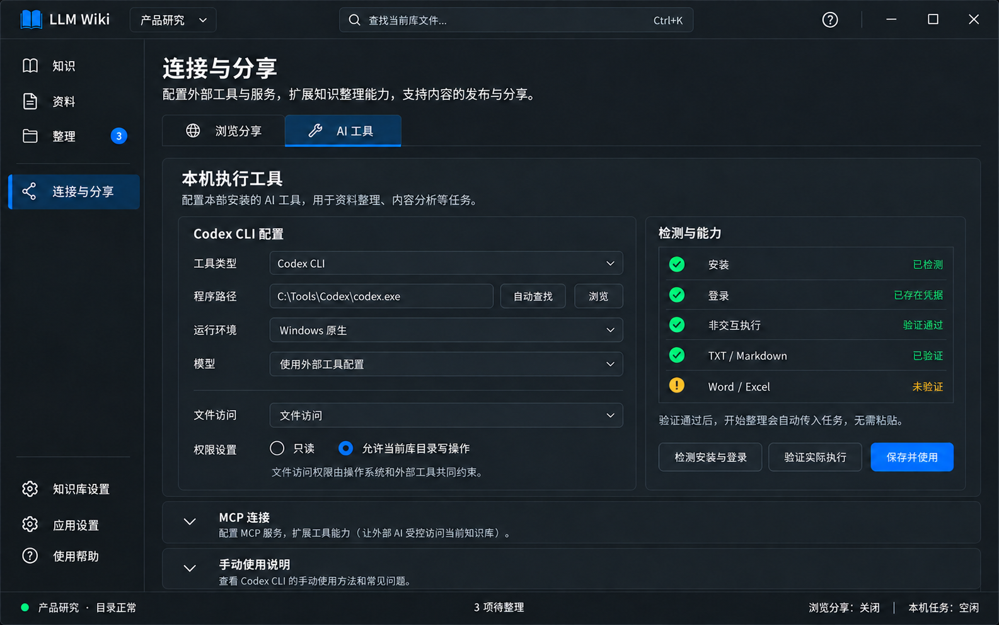

# 页面04｜连接与分享：本机工具、MCP与只读浏览

## 1. 页面目标与概念图

统一管理外部访问和本机执行配置，内部两个Tab：浏览分享、AI工具。AI工具再分本机执行工具、MCP连接、手动使用说明，不新增主导航，也不在应用设置重复配置。



图示是Codex CLI原生配置检测通过的示例；程序路径只是示例，不硬编码。TXT/MD已验证不代表Word/Excel/PDF/PPT或图片已验证；新增格式放在同一检测卡的展开列表，图未穷举全部类型。该图不代表已在用户机器完成适配或安装。

## 2. 控件、布局与样式

| 区域 | 控件/项目封装 | 要点 |
|---|---|---|
| 页签 | ui:TabControl + wpf:TabItem | 浏览分享/AI工具，选中蓝底或下划线与可读标题 |
| 本机配置 | AgentToolSettings + ComboBox、TextBox、Button、RadioButton | 左表单约65%，右检测卡35%；窄窗检测区下移 |
| 检测结果 | ItemsControl + SymbolIcon、TextBlock、InfoBar | 安装/身份/实际执行/格式能力逐项，文字+图标 |
| MCP | CardExpander、ToggleSwitch、PasswordBox、Buttons | 地址、授权库、档位、凭据默认掩码、状态真实 |
| 浏览服务 | BrowserSharePanel、ToggleSwitch、NumberBox、InfoBar | 默认关闭，实际端口、地址/PIN/二维码和停止 |
| 手动说明 | Expander + 只读文本、HyperlinkButton | 辅助入口，非日常前置接入步骤 |

页外距24、卡片内20、区块距16；输入32—36高，标签14、说明12—13。边框与卡片统一Stroke/CardSurface，不做彩色大圆/渐变。选择器弹出项、RadioButton、ToggleSwitch的正常/选中/失焦/禁用在深浅主题完整覆盖，不能只改主表单底色。凭据复制/显示按钮始终可见且有无障碍名称。

## 3. 两个维度必须解释清楚

| 维度 | 作用 | 选择 |
|---|---|---|
| 执行入口 | 谁让AI开始 | 本机启动器、复制指令、导出任务 |
| 资料访问 | AI如何读写 | 文件访问、MCP受控访问 |

MCP不是与启动器互斥的执行器。浏览分享则是另一种只读网页访问，不发整理任务。文件访问使用操作系统权限，不能冒充仅wiki的MCP强制限制；UNC共享读写也不受MCP只读开关约束。

## 4. 本机工具配置字段与Ready条件

首个明确适配目标Codex CLI原生非交互模式；未实现适配器不能作为已可用类型列出。工具安装在本机不等于只选路径即可调用，Codex桌面应用也不等于原生CLI。

| 字段/按钮 | 数据和行为 |
|---|---|
| 工具类型 | 内置adapterId；不让用户填任意shell模板 |
| 程序路径 | 用户选择真实codex.exe绝对路径；自动查找结果先展示，再选择 |
| 运行环境 | 首版Windows原生；不偷偷转WSL路径或调用 |
| 模型 | 默认只读展示“使用外部工具已有配置”，不收API Key |
| 访问方式 | 首个验收为文件访问；CLI+MCP组合另测，未通过不开放 |
| 权限 | 只读/允许当前库目录写操作；首次启用写配置明确确认 |
| 检测安装与登录 | 版本、exec参数能力、login状态；不发整理任务 |
| 验证实际执行 | 隔离临时目录的真实非交互测试；按钮旁说明会用已有账号和额度 |
| 保存并使用 | 保存配置；只有所需能力实际通过才成为本机Ready |

VM独立保存Configuration、DetectionResult、AuthenticationState、ExecutionProbe、FormatCapabilities、IsProbing/ProbeError。Configured、Detected、Authenticated、ExecutionVerified、Ready分开，不能一个IsConnected同时代替。

只读配置可分析/检查，不能假装能写回知识。格式能力使用不含敏感数据的小样本独立测试：DOCX/XLSX/PPTX/PDF文字、旧版DOC/XLS/PPT、结构化文本、图片视觉/OCR分开记录，宏启用格式不执行宏。TXT回复成功不推断其他格式；同类不同后缀不能仅按组名判通过。程序/版本/宿主身份或读取器变化后重验相关能力。无Ready适配器时整理页解释原因并保留明确复制兜底，不内部复制后伪装已执行。

检测卡用ItemsControl+可展开列表显示“格式/访问方式/读取途径/状态/最近验证/限制”，状态为已验证、未验证、不支持、需要外部处理；“验证所选格式”只运行需要的探测，不每次重测所有文件。记录键至少包含adapter身份与版本、具体格式、file/MCP访问、提取器版本及OCR/视觉模式。MCP提供文字提取能力不等于直接文件模式也有该能力，PDF文字通过不代表扫描PDF通过。基础Ready与本次所需FormatCapabilities分别判断。

## 5. Codex CLI实际调用合同

以下参数已按本次整合所依据的 [OpenAI官方CLI参考](https://learn.chatgpt.com/docs/developer-commands?surface=cli) 与 [非交互说明](https://learn.chatgpt.com/docs/non-interactive-mode) 核对；实际版本仍须在工程验证。官方合同不等于本机测试通过。

安装检测执行所选程序的`--version`与`exec --help`；身份用`codex login status`。凭据存在不证明网络/账户可用，所以另做实际执行测试。登录在外部工具完成，本应用不读取或复制认证文件。

```text
Executable = 用户选择且验证的真实原生 codex.exe
WorkingDirectory = 本次绑定知识库绝对路径
ArgumentList = ["exec", "--json", "--color", "never",
                "--cd", 知识库绝对路径,
                "--skip-git-repo-check",
                "--sandbox", "workspace-write", "-"]
StandardInput = 完整自包含任务（UTF-8）
```

只读任务sandbox值为read-only；workspace-write仅在用户启用文件写配置后使用，它不是仅wiki约束。非Git知识库使用相应检查参数，不偷偷git init；不加yolo、danger-full-access、忽略用户规则或跳过信任的参数掩盖失败。

只找到.cmd/.ps1包装时，不用ShellExecute打开空终端冒充本机适配。首版可要求真实原生exe；若新增Node宿主适配，需分别验证node.exe和固定脚本入口，仍通过参数数组，不拼shell字符串。

## 6. 本机调用链、事件和取消

```text
StartLocalRunCommand
 → 库/范围/规则/权限/格式能力重验
 → 保存Task与Attempt
 → adapter构建ProcessStartInfo与参数数组
 → 启动重定向stdin/stdout/stderr的实际进程
 → 先并行读取两路输出，再写完整UTF-8指令、Flush并关闭stdin
 → 解析JSONL事件，等待退出与输出收尾
 → 保存Attempt结论，Task进入NeedsReview
```

ProcessStartInfo：UseShellExecute=false、CreateNoWindow=true、三路Redirect=true、WorkingDirectory明确、UTF-8编码、ArgumentList传参。所有IO异步，不在UI线程等待，不用SendKeys/剪贴板自动粘贴或点击终端。CancellationToken停止读IO不等于进程已取消。

适配器职责ProbeAsync、ValidateExecutionAsync、BuildArguments、ParseEvent、RequestCancelAsync；Task/回执/变更由应用服务持有，适配器不清待整理。保存PID、启动时间、程序身份和attempt归属，不能重启后仅凭PID认领。

| 事件/结果 | UI与状态 |
|---|---|
| thread.started/turn.started | 已开始，不当作源已读取 |
| item类事件 | 有依据才展示阶段/文件，不把所有命令当整理成功 |
| turn.completed | 结束候选，等待实际进程退出/输出收尾 |
| error/turn.failed/非零退出 | 异常结束，核对部分结果，不自动回滚 |
| 退出0且事件完整 | 外部程序已结束待核对，不自动清源变更 |
| 退出0但缺事件/不支持解析 | 程序已退出结果未知，允许人工核对 |

若进程已退出但继承管道未关闭，输出收尾应有可配置有限等待（默认3秒），超时标记输出不完整并进入待核对，不无限卡运行；不杀不属于本次的子进程。未知附加字段兼容，关键事件格式未知标未验证。

取消先请求本次工具，5秒后提供强制结束可靠归属进程，不能误杀其他会话。10分钟无事件只提醒，不默认失败/杀进程。exec首版不承诺交互审批桥接，遇不可交互审批返回NeedsExternalAction，提供外部处理或明确复制分支，不绕过审批。

本机验收：清空剪贴板后在应用选测试txt并点开始，不碰其他窗口，应自动传入、收到事件并产出可核对结果。仍要求去粘贴，直接判不通过。

## 7. MCP受控连接

默认关闭、回环监听、只读；绑定用户确认的单库，与浏览服务独立开关/生命周期。启用写入要显式授权和独立写令牌，应用重启恢复只读。LAN高级选项默认关，只在可信网络使用；不承诺本版HTTPS证书管理。

HTTP全部请求Bearer，随机令牌不少于32字节并受保护存储，不进普通配置/任务/日志；Origin只允许无Origin原生客户端或白名单。轮换/换范围使旧令牌和会话失效。stdio首版只读、由外部客户端独立启动，退出桌面不等于退出该进程，授权库写进启动配置而非偷偷跟随视图。

| 能力 | 参数/返回与边界 |
|---|---|
| list_knowledge_bases | 只列授权库，不回本机路径 |
| list_tree | kb、relative_dir，过滤内部状态和回收站 |
| read_file | 注册表允许的源文本及既有wiki文本，返回content/version/totalBytes/nextCursor/complete；JSON等源仍受路径范围约束，不返回二进制伪文本 |
| read_source_content | 已适配原格式，返回sourceVersion、format、临时内容、页/工作表行列/幻灯片定位、提取与遗漏种类、warnings/requiresOcr、游标；不落盘MD |
| search_content | 仅wiki与sources支持的文本，默认20最大50，片段≤200字符；不默认搜索Office/PDF/PPT/图片内容，无正文索引能力时明确范围 |
| get_pending_changes | 受控相对路径/动作/时间，无清除工具 |
| write_wiki_file | content+expected_version；新建expectedAbsent与版本互斥，只有HTTP显式写授权 |

读取每响应至多64KiB UTF-8内容（封装/定位另计），支持cursor、PDF页范围、工作表行列范围与幻灯片范围。后续续读固定源版本，变更返回冲突，不能混读/把截断当完成。complete表示该内容流已读完，仍需同时检查omittedKinds/coverage；无读取器、加密、损坏、需要OCR/视觉、超过解析预算分别给明确错误或部分覆盖状态，不以空content伪装成功。写入上限4MiB UTF-8，超限拒绝，不以多次覆盖损坏文档；源格式扩展不增加MCP原件写权限。

只允许wiki授权文本写回，禁止raw、purpose/schema、.changes/.llmwiki、log；无删除。原子替换前重验版本和授权；人工保护返回MANUAL_REVIEW_REQUIRED。错误区分范围、只读、缺版本、冲突、超大、格式/读取失败和服务不可用，不泄露正文/凭据/其他库路径。

Resources使用逻辑wiki://{kb}/…并复用授权；Prompts保留boundary、batch/incremental_ingest、query、lint、compare、clean；每次请求校验范围权限，不依赖客户端先读boundary或记住历史说明。MCP连接不等于开始任务，不自动确认源变更。

## 8. 浏览分享与库范围

默认关闭，实际端口由系统分配或用户指定，界面显示真实本机与LAN地址，127回环不混成局域网。无LAN地址提示而不是造地址。启动/停止/失败状态来自服务；未选库禁用。

浏览页、全部API与下载都校验4位PIN，旧PIN/认证cookie轮换后失效；二维码默认不含PIN。只读横幅“只读浏览·编辑请回桌面”，允许授权资料/知识/原格式下载，无上传/保存/删除/改配置/工作流执行路由；不是只隐藏按钮。

新增格式沿用同一授权下载入口，返回正确文件名/Content-Type与原字节，不转换成Markdown。无已验证网页预览器则显示原件信息与下载；SVG、结构化数据等不把任意源内容注入分享页执行，原件下载采用附件方式。桌面有内容预览不代表浏览分享自动具备同等预览能力。

每服务会话固定单库。切当前库只换视图，状态栏提示仍在分享哪库；更换范围先停、旧连接/凭据失效、再生成新凭据重启。删绑定库或改全局根目录先停相关服务，停止失败拒绝操作；不静默重启。

MCP与浏览独立，关浏览不能意外关MCP。独立stdio需外部停用/重启，不由桌面凭猜测宣称已停止。只在有可靠数据时显示最近调用，不伪造设备/连接数。

## 9. 状态与错误操作

配置/探测Busy独立于服务Busy；切Tab不丢未提交输入，但程序路径变化即旧验证过期。Token字段仅显示/复制时可见，不回显到错误堆栈。失败归类程序路径、未登录、网络/模型配置、能力、权限、事件格式、超时，各有重试/修复入口，不显示空白成功。

只读连接不能完成写任务应在整理页解释，可用户授权或切明确文件/复制方式；不得静默提权。生成的客户端JSON必须用真实地址/宿主路径与目标客户端验证，不给一份未经核实的“万能配置”。

## 10. 实现步骤与页内验收

先独立状态模型 → 配置检测与真实非交互测试 → 自动stdin/双管道与Attempt → 浏览/MCP服务与授权 → 客户端配置实测 → 图示和两主题状态验收。

- [ ] 保存路径不等于Ready；实际执行/格式能力分别验证；模型账户仍由外部工具管理。
- [ ] 自动启动无需粘贴、关闭stdin、双输出不阻塞、取消真实、未知结果可核对。
- [ ] 原生exe/中文空格路径/非Git目录/未登录/权限受限均有准确反馈。
- [ ] MCP无凭据/跨库/穿越/链接/写禁区被拒，版本与人工保护实际生效。
- [ ] 浏览下载也鉴权，旧PIN/cookie失效；服务范围不随切库静默变化。
- [ ] 生成客户端配置通过真实目标客户端，不以复制JSON当连接成功。
- [ ] 表单、弹出项、开关、徽标、禁用和错误在两主题清楚，无密钥日志。

## 11. 配置、授权、换凭据与服务反馈

本页共用 [总体反馈规范](../00_总体架构与实现约定.md) 的ContentDialog与Notice宿主。检测安装、登录状态、格式验证、客户端配置复制和普通启停不各弹成功框；结果留检测卡或服务卡，必要时短通知补充，不以Toast代替Ready状态。

### 11.1 需要明确决策的框

| ID/触发 | 标题、范围与文案 | 按钮、焦点与结果 |
|---|---|---|
| D08-MCP 开启写档 | “允许AI修改当前库知识？”；520宽，显示绑定库和允许写wiki文本，说明不允许原资料/规则/日志/删除，使用独立写令牌，重启恢复只读 | 取消 / 允许写入知识；初焦取消。提交重验绑定与策略，成功才变写档并显示令牌操作；失败留框，开关仍原真实档位 |
| D08-File 首次启用文件写配置或范围提升 | “允许本机工具在当前库目录写入？”；640宽，显示真实CLI程序、当前库与完整目录，明确这是文件系统权限，不能强制限于wiki，仍受外部工具策略 | 取消 / 允许当前库目录写操作；初焦取消。授权绑定所示工具身份/版本、库与配置；路径/库/权限提升需重新核对，不在每次启动重复问。服务失败不得保存为已授权 |
| D09 更换网页PIN | “更换访问码？”；480宽，说明“旧访问码和已认证浏览会话将失效，需要重新输入新访问码” | 取消 / 更换访问码；初焦取消。服务真正轮换后新码只在服务卡显示，不放正文/普通日志；失败保留原服务真实状态 |
| D09 更换MCP令牌 | “重新生成访问令牌？”；520宽，显示只读/写令牌的具体对象与授权库，说明哪些连接将失效 | 取消 / 重新生成令牌；初焦取消。只轮换用户选择的凭据类型，不能顺手变更另一令牌或库；结果在掩码字段显示，失败不宣称旧令牌已失效 |
| D10 运行时更换授权库 | “停止服务并更换分享范围？”；640宽，列服务类型、原库→新库，说明旧连接/凭据失效，不影响其他独立服务 | 保持原范围 / 停止并更换；初焦保持原范围。停服失败留原范围；停止后新范围启动失败显示已停止，不假称恢复原服务，不静默提写档 |
| D16 首次开放MCP局域网 | “允许局域网访问此MCP服务？”；520宽，显示授权库、监听范围变化，说明仅限可信网络且仍需令牌 | 取消 / 允许局域网访问；初焦取消。成功后显示实际LAN地址，失败回原监听状态；不连带开启写档 |

D08-MCP与D08-File是同一授权框的不同范围模板，不能把文件模式也写成只允许wiki。配置保存必须实际持久化成功才提示成功；普通校验不能自动勾选授权或启用写档。

MCP原有“开启写入需一次确认”与保存配置合并为同一授权提交，不先弹写授权再弹“确定保存”。如果D10换范围回到默认只读，后续写提升由用户另行操作，不能在D10的Busy期间弹D08。关闭只读服务、降低权限不额外警告确认，真实停止/降权完成后更新状态。

### 11.2 通知与持久状态清单

| 场景 | 正确反馈 | 不允许的反馈 |
|---|---|---|
| 检测/实际验证进行中 | 对应按钮Busy与检测卡真实阶段；取消仅工具可取消时提供 | 每个检测阶段弹成功/连接框 |
| 保存本机配置成功 | 短通知“本机工具配置已保存”；Ready/未验证能力在卡片保留 | 仅有程序路径就通知AI已连接 |
| 未登录/格式未验证/能力不足 | 检测卡持久警告与外部登录/重检/配置说明入口 | 自动启动任务或要求复制后却宣称本机执行成功 |
| 验证实际执行失败 | 卡片中文分类原因+脱敏详情，保留输入与重试 | 新错误框盖住配置框，或只发消失Toast |
| 服务启动成功 | 卡片运行中、实际地址、范围、凭据；短通知可选 | 造连接数/客户端已成功连接 |
| 启动/停止失败 | 服务卡持久错误、真实开关状态与重试；不抢焦点 | 先切成关闭再发现停止失败，或只报成功 |
| D09轮换成功 | 信息4秒“访问码已更新，旧访问已失效”/“所选令牌已更新”；新值留对应掩码卡 | Toast直接展示PIN/Token，或未失效就说旧连接断开 |
| 复制地址/客户端配置/凭据 | 通知只写“已复制访问地址/客户端配置/令牌”，不回显具体凭据 | 复制内容进入通知摘要、日志或错误详情 |
| 切库但原服务仍运行 | 全局状态与页内范围说明持久显示原授权库 | 自动换范围或反复弹模态警告 |

同一错误复试更新现有检测项，不每次追加相同Toast。原生CLI的运行输出错误属于整理任务，不在本页另弹一份。独立stdio状态未知以说明保留，不发虚假的已停止通知。

远端MCP请求被拒（只读、人工保护、版本冲突等）时，返回协议错误并更新受控调用记录；不得按每次远端请求自动弹D08/D15或把桌面切到授权页。只有用户主动管理权限/人工保护时才进入相应决策框。

本页反馈验收：两种写范围文案不混淆；凭据轮换/范围改变只执行一次且真实失效；Busy/失败不叠框；无凭据进入通知或普通日志；服务卡与开关始终反映真实结果。
