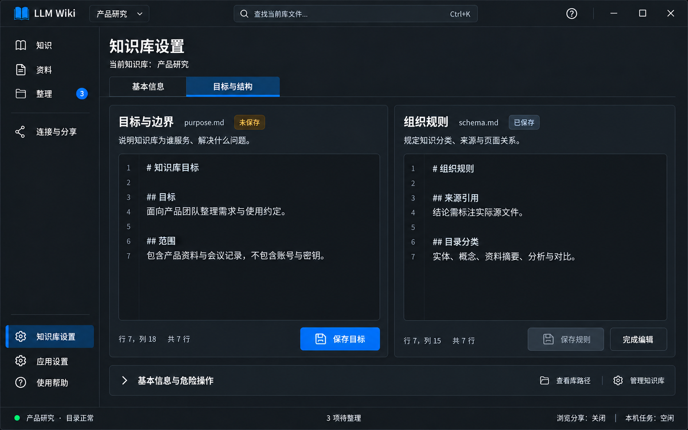

# 页面05｜知识库设置：目标、规则与库管理

## 1. 范围与概念图

只影响当前库，编辑purpose.md和schema.md，查看库路径及危险删库。应用根目录/主题在应用设置，本机工具/MCP在连接与分享，本页不重复配置。

图示目标草稿未保存、组织规则已保存；两个状态独立。文件名是辅助信息，不另套重复标题卡。示例文字供布局，不自动覆盖用户规则。

## 2. 页面区域、控件与样式

| 区域 | 控件/封装 | 责任与尺寸 |
|---|---|---|
| 页头 | TextBlock | 标题26、当前库说明14 |
| 页签 | ui:TabControl + wpf:TabItem | 基本信息/目标与结构；保留草稿 |
| 两个规则编辑区 | RuleEditor + 现有编辑器/多行TextBox | 宽屏等宽，间距16；窄窗上下排列，各自滚动 |
| 状态/动作 | Badge/InfoBar + Button | 文件名、未修改/未保存/保存中/失败；保存目标/保存规则 |
| 基本信息 | TextBlock、HyperlinkButton/Buttons | 真实库名、完整路径、可访问状态、打开/复制路径 |
| 危险区 | CardExpander + ContentDialog | 折叠永久删库，输入库名，只一个确认宿主 |

页外距24、编辑面板20，圆角8、Stroke1；标题18、说明14、路径12等宽；输入/按钮32—36。两个编辑区均用CardSurface、ItemText和SecondaryText，不用不同色系。Tab选中用蓝色指示与完整前景，编辑焦点用2DIP FocusRing；错误留在对应编辑区，状态带文字与图标。选中、焦点、禁用按总体语义键，失焦不丢选中状态。禁用保存仍可读，不靠降低整张卡透明度。

## 3. 数据与命令

Purpose与Schema分别维护Content、OriginalContent、DiskVersion、Exists、SaveState、Error、Busy；只有库上下文与文件服务共享。不可用一个IsDirty导致保存其一就把另一个误清。

| 命令 | 条件 | 结果 |
|---|---|---|
| LoadRules | 库可读、上下文版本有效 | 加载两实际文件，不覆盖未保存缓冲 |
| SavePurpose/Schema | 对应Dirty、可写、非Busy、磁盘版本匹配 | 精确目标写回、记规则变化/日志、继续编辑 |
| LoadDefaultDraft | 对应缺失或用户明确替换草稿 | 模板只填编辑区，不自动落盘 |
| Copy/OpenLibraryPath | 路径真实可用 | 精确路径；失败提示，不伪造成功 |
| DeleteLibrary | 目录可访问、无草稿/写任务、服务可停 | 一次危险确认后永久删除 |

缺文件显示“目标文件缺失/规则文件缺失”，可载入默认模板；已有草稿替换前明确选择，不能悄悄丢内容。Markdown是唯一规则来源，不存第二份表单事实。模板通用/研究/读书/业务只预填文字，不改变目录。

## 4. 保存与离开

未改保存禁用；保存中防重复、锁目标，成功更新原缓冲/版本并留编辑；失败保留草稿原因+重试。磁盘外部变化不覆盖，显示磁盘版本/另存/返回。语义编码策略明确，不用乱码写回。

两个文件都有草稿时，离开只弹一次，列两文件并选“保存全部并继续/放弃更改/留在此处”。一项成功一项失败：留当前页、保留失败草稿，成功项不回滚成未保存，不为失败另叠弹窗。

切库/改根目录/关窗都由全局协调器调用此规则，不能只保护本页Tab切换。正常退出保护不承诺崩溃草稿恢复。

## 5. 规则更新怎样闭环

规则哈希真正改变时持久提醒“规则已更新，已有知识尚未按新规则核对”。下一次准备任务自动用最新版本；旧指令不作为新任务复制，但已经执行的旧任务仍能逐项核对，不能借此清新提醒。

“稍后处理”只折叠当前版本提醒，保存ignoredVersion，不等于处理完成。全部资料按当前规则确认后还需显式“确认已按新规则核对现有知识”；也可人工全库核对后独立确认。部分任务不能清全库提醒，规则变更不伪造源资料修改。

## 6. 基本信息和永久删库

此处删除整个库仍永久删除，包括原格式资料、Wiki、隐藏任务/回执与回收站；与资料页可恢复移除不同。危险区一次展示库名、完整路径、后果，要求输入完整库名，按钮“永久删除此知识库”。不能只写“确定”。

先解决草稿；本机执行未终止则先返回任务，不能删。停止绑定浏览/MCP服务，失败拒绝；目录不可达或无权限拒绝。执行期间防重复；部分失败保留真实损坏/残留信息，不重新造空骨架掩盖。删除后选其他库或无库引导。

本轮不提供库重命名，避免破坏Agent路径；不将普通子目录自动识别初始化为库。新建/切换的高频入口仍是顶栏，不在这里再做一个首页列表。

## 7. 实现步骤与验收

真实规则加载 → 独立双草稿/版本保存 → 全局离开保护 → 规则哈希提醒与全库确认 → 基本信息/服务联动永久删除 → 主题/布局验收。

- [ ] 目标/规则独立保存、失败不丢；保存其一不误清另一草稿。
- [ ] 缺失模板先入草稿，外部冲突不静默覆盖。
- [ ] 深浅主题编辑器/Tab/状态/禁用可读，窄窗不横向挤压文字。
- [ ] 规则提醒可稍后但不假完成，旧任务确认不清新规则版本。
- [ ] 永久删库确认范围、库名、服务/进程停止与不可达保护均真实。

## 8. 规则与删库的弹框、通知

### 8.1 规则编辑

D02未保存框复用总体模板；两个草稿一次列出，初焦留在此处。保存目标/规则的普通成功用N01“目标已保存”/“组织规则已保存”，对应编辑区更新状态；随后规则更新是持久InfoBar，不再额外弹“是否重新整理”。稍后处理只折叠提醒，不提示已完成。

外部版本冲突复用D04并明确实际对象是purpose.md或schema.md，不能把另存独立资料的成功当成当前规则已保存。允许导出/另存草稿时明确“原规则未更改”，是否继续离开需用户选择保留副本后继续；不能自动覆盖原规则。已有D02时只切当前框子视图。

**D14 默认模板替换草稿**：缺文件且编辑区空白时，载入模板只填草稿，无需确认；已经有输入时才弹520宽框。标题“用默认模板替换当前草稿？”；说明“将替换‘{目标与边界/组织规则}’当前未保存输入，不会立刻写入文件”，显示将填入的模板摘要。按钮保留当前草稿/载入默认模板，初焦保留当前草稿。确认后只替换相应缓冲并标未保存；不自动保存、不改另一编辑区、不再发保存成功通知。

### 8.2 D07永久删除知识库

从折叠危险区主动点击触发，640宽。标题“永久删除知识库”；对象卡显示真实库名、完整根路径，列“资料、知识、任务状态、库内回收站将一并删除，无法通过本应用恢复”。输入标签“输入知识库名称以确认”，空输入提示真实名称，禁止预填为已经确认。

按钮取消/永久删除此知识库，初焦取消；危险按钮仅输入与目标显示名称匹配且库可访问、无运行写入、草稿解决、服务可停时启用。输入框按Enter不触发永久删除。路径长可换行并可复制，不能只显示可能歧义的库名。

确认后在同框显示“停止相关服务→删除中”等真实阶段，防重复与误关；停止失败不删，原框说明与重试。删除部分失败显示实际残留与“部分内容未删除”，不Toast全成功，不重建空骨架。失败之后允许返回库管理/查看残留，不承诺已删除内容能恢复。全部成功才关闭、切到其他库或无库引导并通知“知识库已删除：{名称}”。

若先因草稿/任务不能执行，优先在危险区就地显示阻断原因和返回任务入口，不先把用户推进一个只能点击取消的删库框。需要离开保护时由总体协调器处理，不能D07上再叠D02/D13。

本页反馈验收：空输入/Enter不会删库，名称/路径/回收站后果明确；D14不自动落盘；两份草稿一成一败仅留一个框且状态准确；规则提醒不是重复模态确认。
