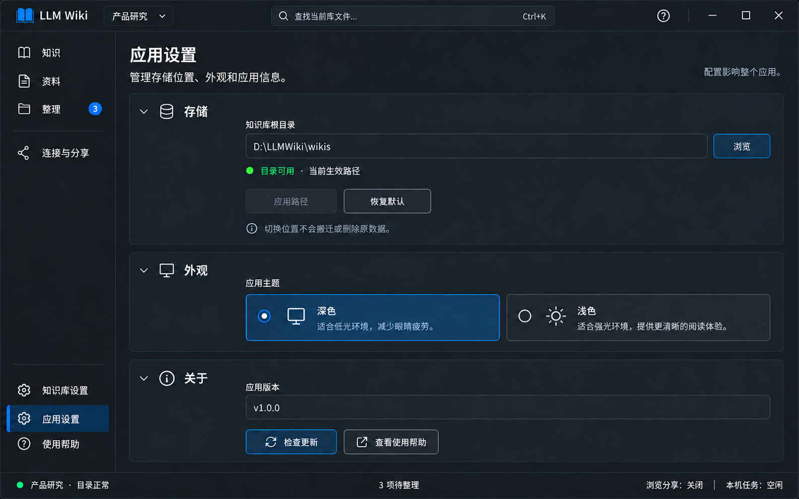

# 页面06｜应用设置：存储、外观与关于

## 1. 范围与概念图

影响整个应用，管理知识库根目录、主题和版本。不重复库目标规则或AI工具配置，不新增模型API设置。

图示当前路径可用且未改，所以应用路径禁用；深色主题已选。版本为示例，程序必须读实际程序集，不能把图中文字固定写入或伪造已是最新。

## 2. 区域控件与样式

| 区域 | 控件/封装 | 样式和行为 |
|---|---|---|
| 存储卡 | StorageSettings + CardExpander/TextBox/Buttons/InfoBar | 标签知识库根目录；浏览/应用/恢复默认；区分当前与待应用 |
| 外观 | AppearanceSettings + RadioButton/Toggle样式卡 | 深色/浅色两项，选中蓝底边框/圆点/文字，不能只颜色 |
| 关于 | TextBlock、Button、HyperlinkButton | 实际版本、已有更新服务、帮助入口 |
| 页面滚动 | Grid+受控ScrollViewer | 卡片纵向流，不把整个导航滚走 |

外距24、卡片间16、内距20；每张CardSurface圆角8，Stroke1。表单标签14，输入32—36，路径可横向滚/选中复制。主体最大宽约960，超宽不把表单无限铺开，窄窗按钮折到下一行。

主题选项的正常/悬停/选中/失焦/键盘焦点/禁用完整；当前深色#174B72+指示，不出现白底黑字失配。应用路径禁用仍有可读标签并显示“路径未变化”；主题不能通过降低整页面透明度处理。

切主题须更新当前七页、已有弹框/通知/InfoBar、下拉与菜单、虚拟列表，以及PDF文字、办公内容、表格、JSON等预览内部配色；不能只换Shell背景。由统一主题服务切换资源字典，业务VM/草稿/选中/滚动不重建。图片或原页面截图保留原色，容器按主题；不把全部文档全局反色。打开弹框期间不允许点击底层设置页，跨主题验证通过测试调用主题服务完成。完整合同见总体第8节。

## 3. 数据、验证与CanExecute

StoragePathCurrent与StoragePathInput分开；ValidationState、ValidationVersion、ResolvedPath、Error、IsApplying独立。Theme和About状态另块，不塞路径query。只有最新输入对应的校验结果决定按钮。

| 输入状态 | 页面文案 | 应用 |
|---|---|---|
| 空/非法 | 请填写根目录/路径格式不正确 | 禁用 |
| 校验中 | 正在检查目录 | 禁用 |
| 可用未改 | 当前生效路径 | 禁用 |
| 可用且改变 | 目录可用 | 启用 |
| 不存在但可创建 | 应用后创建目录 | 可用，提交前再验证 |
| 无权限/不可达 | 真实原因+重试 | 禁用 |

路径支持盘符/UNC/按稳定配置基准解析的相对路径，展示解析绝对路径；合法格式不等于可访问。按需要验证读写，临时试写不触碰用户资料并清理。异步取消/版本检查防旧输入成功结果启用新输入。

Browse用系统选择器/现有封装，不重写资源管理器；已有局域网枚举仅辅助，失败不阻塞手输UNC。RestoreDefault只改输入，用户应用后生效。默认系统Documents/LLM Wiki/wikis，不硬编码用户名。

## 4. 应用路径的提交顺序

1. 输入改变→异步校验→就地显示新旧路径；说明只切读取位置，不搬迁/合并/删除原数据。
2. 有本机运行任务先返回并结束/取消核实，不能运行中换根。
3. 处理所有文档草稿；取消任何一步即取消本次切换。
4. 提示并停止绑定浏览与HTTP MCP，阻止新请求；独立stdio需外部停用/重启，桌面不假称已停。
5. 再验证/创建目标根，按既有规则读库列表；不自动把任意子目录初始化成库。
6. 准备成功后可靠保存配置、更新上下文版本、清旧选择/缓存/不适用指令，再显示新库。任务身份不能按同名库盲配。
7. 失败保留旧生效配置和上下文；已停服务保持关并说明可手动重开，不偷偷重启；不重新复制旧数据。

不可达不自动切回本地或建同名空库。UNC权限由Windows管理，不提供账号云同步；提示避免多机同时维护同文件，修改者负责整理。不同设备映射盘符不同，不承诺外部Agent天然可读。

## 5. 外观与关于

只提供深色/浅色，切换即时且持久；同时覆盖树、列表单元格、菜单、弹出项、Tab、Markdown内部、编辑器、通知与对话。主题按钮状态来自实际主题，保存失败提示，不把未持久化偏好冒充已保存。

导航折叠持久化；各页筛选/未生成输入会话保留，Task跨重启持久，文档崩溃草稿不保证恢复。配置保留wikisDir与未知字段，新增UI命名空间；凭据不放普通配置。

版本读实际程序集。检查更新只使用项目已有可靠渠道，显示检查中/有更新/最新/失败；无服务则不放假按钮，可显示已验证的已有下载入口。关于页面不暴露内部实施说明或伪造真实版本。

## 6. 命令与实现步骤

ValidatePath输入变化去抖并版本化；ApplyPath由最新有效变化与非Busy决定；RestoreDefault仅填；ChangeTheme立即应用并持久；CheckUpdate有渠道且非检查中才可用。浏览/更新失败都有可操作原因。

先映射配置服务 → 当前/输入隔离和路径校验 → 跨页草稿/任务/服务协调提交 → 动态全主题资源 → 版本与真实更新 → DPI/窄窗与故障回归。

## 7. 本页验收

- [ ] 旧异步校验不覆盖新输入；未改禁用/合法启用与真实路径一致。
- [ ] 更换根不搬数据，不静默重启分享，不把同名库误配旧Task。
- [ ] 校验/创建/配置写失败保留旧生效路径；草稿取消真正中断切换。
- [ ] 深浅主题全组件与选中失焦可读，主题持久失败不假成功。
- [ ] 本机运行中不能换根，独立stdio停止责任说清；UNC断网不造空库。
- [ ] 版本和更新来自真实程序/服务，图示数值不固定成产品数据。

## 8. 路径切换与偏好的反馈设计

字段非法、正在校验、不可达均在路径输入下方反馈，不弹“路径错误”框；恢复默认只改输入，没有“确定恢复吗”。未修改的应用按钮禁用且说明路径未变化。

**D11 应用根目录**：用户点击已校验的新路径触发，640宽。标题“应用新的知识库位置？”；对象区清楚显示当前路径→新路径，说明“只更换读取位置，不搬迁、合并或删除原数据”。列将停止的浏览/HTTP MCP及原绑定库；没有运行服务就不显示虚假影响项。新目录将创建时明确说明；独立stdio提醒需到外部客户端停用/重启，不谎称应用可停止。

按钮保留当前路径/应用新路径，初焦保留当前路径；无运行本机任务且草稿已解决后才允许进入提交。确认只执行一次既定事务，不再为停止各服务分别弹确认。若先需D02，协调器先完整解决草稿再展示路径决策，不叠两个框。

提交中在同框依真实阶段显示校验、停服、准备目录、保存配置，防重复；取消仅提交前或后端明确可取消阶段可用。失败留框保留路径输入和原生效路径，显示“原位置仍生效；相关服务已停止”或实际停止失败情况，不能静默重启服务。成功关闭并在新上下文刷新，短通知“知识库位置已更换”，服务状态仍为真实关闭。

| 场景 | 反馈方式 |
|---|---|
| 路径异步验证 | 字段下文字/图标、输入版本绑定；不随每次输入发Toast |
| 深浅主题切换 | 选中主题即时变化，无成功框，不每次点击Toast；保存失败InfoBar“主题已应用，本次偏好未能保存”+重试保存 |
| 导航折叠偏好失败 | 不回滚用户当前布局；就地/设置区提示未持久化，提供重试，不弹错误框 |
| 检查更新中/无更新 | 关于卡内显示检查中/已是最新，保留真实版本；无模态成功框 |
| 有更新 | 关于卡InfoBar“发现新版本 {实际版本}”+查看下载；不自动打开浏览器或安装 |
| 检查更新失败 | 关于卡内原因与重试，不能显示最新，也不遮挡其他设置 |

本页反馈验收：应用路径只一次决策，失败不假称新路径生效；D11确认之前不先停服务；主题与偏好失败不出现矛盾状态；所有消息深浅主题可读，旧路径校验消息不覆盖新输入。
