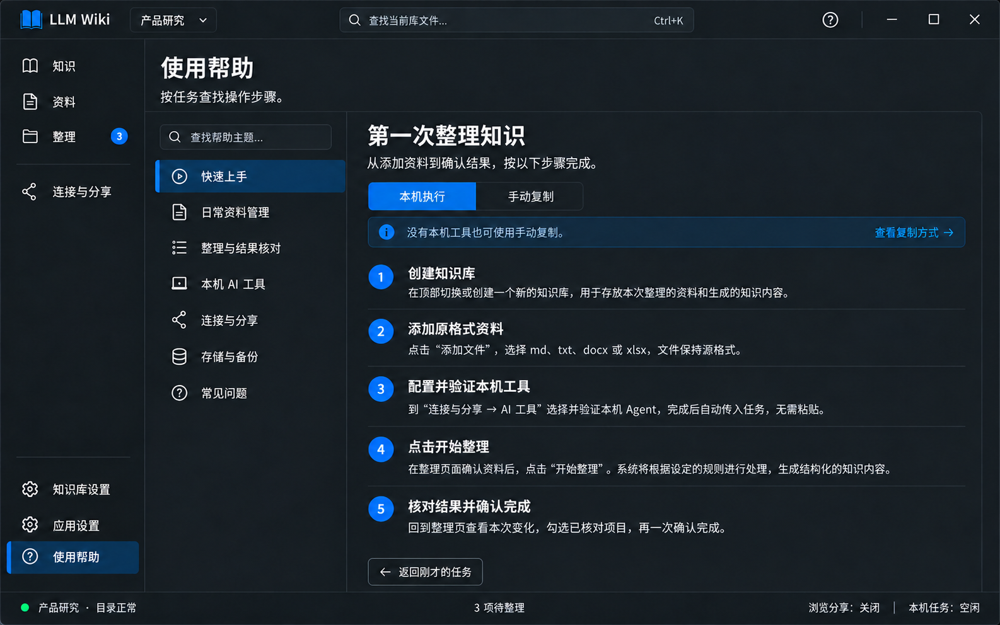

# 页面07｜使用帮助：按任务说明与就地返回

## 1. 目标与概念图

帮助用户完成实际操作，不堆术语或开发配置。主导航底部“使用帮助”；其他页错误/首次说明可带topicId和原页上下文跳入。

图示快速上手、本机执行说明，另有手动复制Tab；两者都说明核对与确认，不将进程结束说成知识已完成。帮助内容基于 [整体使用说明](../使用说明.md)，避免两套相反步骤。

## 2. 区域控件与样式

| 区域 | 控件/封装 | 要求 |
|---|---|---|
| 页头 | TextBlock | 标题26、说明14，不装饰大Banner |
| 帮助主题 | HelpTopicList + ListBox/TextBox/SymbolIcon | 宽240—260，行40；标题/关键词过滤，不语义搜索 |
| 正文 | HelpTopicPanel，安全Markdown/FlowDocument或TextBlock/Expander | 正文14—15行距24，章节18，段距12 |
| 方式切换 | ui:TabControl+wpf:TabItem | 本机执行/手动复制，同一主题内，不跳另一页 |
| 就地链接 | HyperlinkButton/Buttons | 路由到具体页与区域，运行前仍经过全局保护 |
| 返回原任务 | Button + NavigationReturnContext | 只有有效返回上下文才显示，不猜目标 |

外距24、主题/正文距16，正文24—32内距；可读宽680—820，独立滚动。主题选中整行蓝底与白字/图标，正文获焦后仍保留，浅色按主题替换；不使用黑字树或白块选择。编号是简单文字圆底，不为教程引入复杂图形库。

## 3. 内容结构与数据

主题固定为快速上手、日常资料管理、整理与结果核对、本机AI工具、连接与分享、存储与备份、常见问题。TopicId、Title、Keywords、Blocks/Content、RelatedRoutes可静态配置；SelectedTopic、SearchKeyword、ReadMode、ReturnContext独立VM状态。

帮助是随程序版本发布的本地内容，不必联网，不自动扫用户资料。原始资料和外部Agent输出不能变成帮助页面的可执行指令。外链只打开已验证官方/项目链接，失败提示，不能自动运行网页附带命令。

## 4. 本机执行/复制的步骤内容

| 步骤 | 本机执行说明 | 手动复制说明 |
|---|---|---|
| 建库 | 顶栏创建/选择库 | 相同 |
| 添加资料 | 资料页按类型添加PDF、Word、表格、PPT、文本、JSON等数据或图片，保持源格式 | 相同 |
| 准备工具 | 连接与分享→AI工具，选择CLI、检测并实跑验证 | 无需先配工具或单独粘贴边界 |
| 发起 | 整理页选范围，开始整理，应用自动传任务 | 复制整理指令，去能访问路径的外部AI粘贴 |
| 核对 | 外部程序结束后查看本次变化 | 返回任务点“我已在外部执行，核对结果” |
| 完成 | 勾选已核对项一次确认，剩余保留 | 相同，不因复制完成就自动清除 |

本机账号/模型由外部工具管理，不能在帮助里写“在应用设置配置API模型”。MCP是访问方式，不能说打开MCP即开始。上传格式以总体第3.1节为准，支持常见办公/PDF/数据/图片，不用“上传任意文件”误导；已入库、可预览、可编辑、AI可读取分开讲。

## 5. 常见问题必须给操作出口

- 上传后知识不变：去整理，不把保存成功当AI已完成。
- 任务一直待核对：主动核对；零变化可填无需修改；部分完成可结束任务保留剩余。
- 本机仍需粘贴：当前是复制模式或适配未通过，去AI工具查看Ready分项，不能假称本机已接通。
- PDF/Word/表格/PPT无法预览：打开原文件，已保存状态不受预览失败影响；AI读取能力另验证，扫描PDF/图片查看OCR/视觉能力，表格和PPT核对完整范围。
- 文件已保存记录失败：重试登记，不重复上传。
- 误删资料：资料更多→回收站恢复；同名另存，已清理知识需重新整理。
- 路径切后内容不见：检查新根不搬数据，回旧根而非新建同名空库。
- 手机无法访问：检查服务、同网、真实LAN地址与访问码，不建议关闭全部防火墙。
- 规则保存后旧知识不变：按新规则核对后显式完成，不是自动重写。

文字和实际按钮名一致；帮助中的链接必须对应真实命令，不提供暂未实现的入口。

## 6. 跳转、返回与状态

OpenHelp(topicId,returnContext)先保护旧草稿，保存原页、库/任务身份和定位。返回不覆盖当前文件，仍检查库/任务是否存在、全局草稿和运行约束；失效则说明并回相应页面，不制造新任务。

同页切主题保留搜索与滚动会话；搜索无结果显示清空按钮。正文加载失败（若从包资源加载）用明确错误，不以空白帮助冒充成功。默认首开快速上手，来源错误提示可直达主题。

## 7. 实现步骤与验收

从使用说明提取本地主题 → 建立route映射与返回上下文 → 完成两执行方式教程 → 就地错误链接 → 深浅主题和键盘/缩放 → 按真实应用走查校正文案。

- [ ] 帮助支持离线，章节与使用说明及按钮名称一致。
- [ ] 本机工具配置不要求复制任务，复制分支不强迫MCP；帮助列举格式与统一注册表一致，不遗漏新支持格式或宣称任意文件。
- [ ] 主题选中失焦、链接焦点、编号和两Tab在两主题可读。
- [ ] 返回原任务/库失效/草稿未保存的分支正确，不丢上下文。
- [ ] 失败、部分完成、零知识变化、回收恢复都有明确操作步骤。

## 8. 帮助页的轻反馈与提示说明

本页不设计普通模态框。主题选择、方式Tab、帮助过滤、阅读步骤不发成功Toast；无结果就地“没有匹配的帮助主题”+清空筛选，资源加载错误在正文位置显示原因和重试。

返回上下文已失效时用正文顶部InfoBar“原任务已不存在或当前库已变化”，提供返回整理/留在帮助，不自动造Task、不弹“是否返回”框。打开帮助链接触发真实页面跳转时，若原页面仍有草稿，复用总体D02；帮助页自身不再套一个确认。

外链打开失败只一次短错误提示并提供重试，链接仍保持可操作；不显示网络堆栈/凭据。系统浏览器打开是用户点击后的行为，不因帮助资源载入自动触发。

帮助中增加“认识弹框与通知”主题小节：蓝/绿短消息是结果；带重试/处理入口的页内提醒会持续；未保存框Esc表示留在原处；永久删除必须明确确认；移入回收站后的撤销过期仍可从回收站恢复。告诉用户关闭提示不等于解决业务问题。

本页反馈验收：无重复成功提示；帮助失败/返回失效都可恢复；就地链接经过全局草稿保护但不叠框；文案与各页实际D/N一致。
